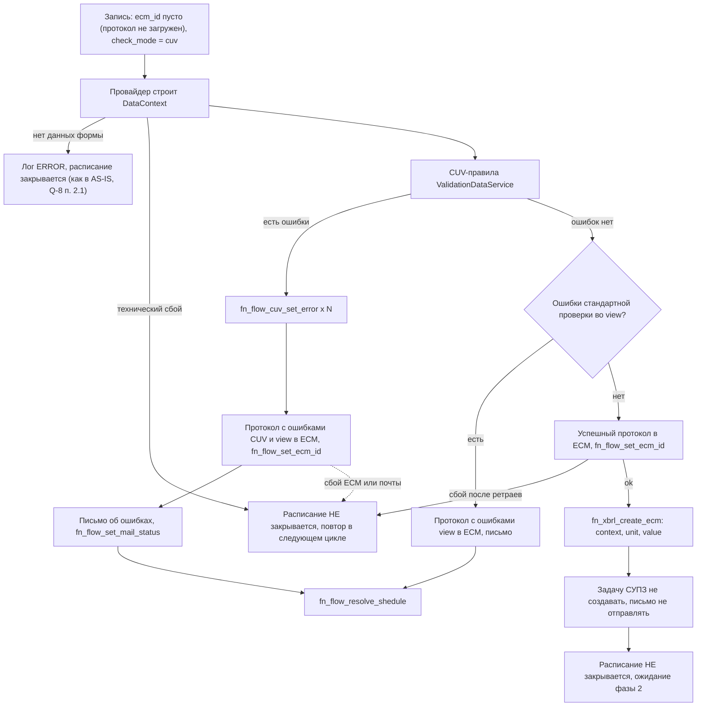
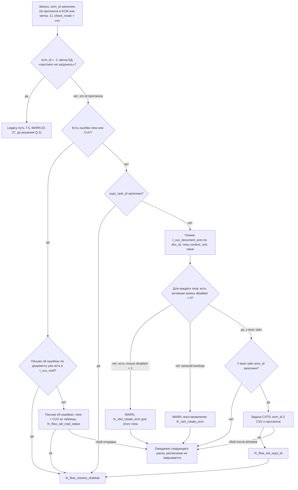

# gmap2-vux-ecm. Доработка: CUV-проверка → протокол → выгрузка CSV в ECM → задача в СУПЗ

| Атрибут | Значение |
|---|---|
| Сервис | `gmap2-vux-ecm` (модуль `service`, пакет `ru.sbrf.gmap.vux`) |
| Тип документа | Системная аналитика (постановка на доработку) |
| Документ | `docs/analytics/cuv-csv-ecm-supz-flow.md` |
| Статус | Реализация выполнена, сборка и тесты не выполнялись. Что осталось — раздел 2 |
| Базовая версия (AS-IS) | Текущая промышленная версия сервиса `gmap2-vux-ecm` |
| Связанная задача | VUXPKAP-1710 |

---

## 1. Назначение и цели

### 1.1. Бизнес-цель
После успешной межформенной (CUV) проверки отчёта необходимо:
1. сформировать и сохранить в ECM протокол проверки;
2. инициировать выгрузку данных отчёта (context / unit / value) в CSV и их сохранение в ECM — выполняет **внешний сервис** по записям в `t_vux_document_ecm`;
3. только после того, как все CSV получили идентификаторы ECM, создать задачу в СУПЗ, приложив к ней ECM-идентификаторы протокола и трёх CSV.

### 1.2. Цели доработки сервиса
- Перевести формирование CSV из Java (`DtoToCsvFileService` + прямая загрузка в ECM) на асинхронную схему через БД-функцию `fn_xbrl_create_ecm` и таблицу-очередь `t_vux_document_ecm`.
- Разделить обработку CUV-документа на **две фазы** в разных запусках шедулера (раздел 7).
- Обеспечить повторное создание записей выгрузки, отклонённых внешним сервисом (`disabled = 1`).
- Сохранить текущее поведение для стандартной проверки (`check_mode = null`) и при ошибках.

### 1.3. Вне рамок (на текущей итерации)
- Логика XML-проверки (`check_mode = xml`) — требований нет, появятся в будущем; проверок этого типа сейчас нет (D-11).
- Реализация внешнего сервиса, формирующего CSV и загружающего их в ECM.
- Обновление автотестов — выполняется после реализации функционала (раздел 11).
- Подключение к CUV-проверке других отчётных форм, кроме 0420415.1.3. Что для этого нужно — 7.6, вопрос Q-14.

---

## 2. Статус: что осталось

Код доработки написан (состав — раздел 14), но ещё ни разу не собирался и не тестировался. Выпускать нельзя, пока не решён вопрос Q-1.

Вопросы в 2.2 написаны так, чтобы их можно было прочитать без остального документа.

### 2.1. Что сделать до выпуска

1. **Получить ответы на открытые вопросы (2.2).** Выпуск блокирует Q-1, остальные вопросы влияют на поведение, но не блокируют.
2. **Работы, не зависящие от ответов:**

| # | Что сделать | Кто |
|---|---|---|
| 1 | Собрать проект (`mvn clean package`) и исправить ошибки компиляции. Код доработки ни разу не компилировался | Разработчик |
| 2 | Написать тесты: сценарии приёмки T-1…T-21 (раздел 11) и дополнительно — пересоздание отклонённых записей выгрузки CSV, восстановление пропавших записей выгрузки, несколько активных записей выгрузки одного типа, частичный сбой создания записей выгрузки, сбой сохранения задачи СУПЗ в БД. Переписать отключённый `OrchestratorServiceIntegrationTest`, добавить новые колонки в тестовую view H2 и таблицу `t_vux_document_ecm` в changelog | Разработчик |
| 3 | Доработать логи: добавить `scheduleId` в сообщения о выгрузке CSV (`[CSV-EXPORT]`), код формы, режим проверки и фазу — во все сообщения по записи, префиксы — в оставшиеся сообщения. Либо упростить требования к логам (10.1) | Разработчик |
| 4 | Проверить на тестовом стенде право учётки сервиса на чтение `t_vux_mail` (проверка ENV-7) или запросить его у команды БД | Разработчик, команда БД |
| 5 | Привести CUV-проверки к постановке (7.7): включить и переписать проверку 10, исправить проверку 8 (неверный код ошибки), остальное — по решению Q-8 п. 5. Нужны ответы и данные по Q-8 | Разработчик |
| 6 | При выкатке: сначала обновить в БД view расписания и справочник типов документов, потом выкатывать сервис. Иначе сервис не сможет прочитать view и не обработает ни одной записи. После обновления БД выполнить проверочный запрос из 10.3: для формы 0420415.1.3 должно быть `check_mode = 'cuv'` | DevOps |

### 2.2. Открытые вопросы

Порядок — по важности. Закрытые вопросы удаляются, ответы вносятся в текст документа и в журнал решений (раздел 13).

#### Q-1. Повтор письма, протокола или задачи СУПЗ после сбоя записи в БД

**Приоритет:** высокий, блокер выпуска. **Кому:** аналитику.

**Ситуация.** Сервис сначала выполняет внешнее действие, а затем записывает факт в БД отдельной функцией. Таких пар три:
- отправил письмо об ошибках → записывает факт отправки (`fn_flow_set_mail_status`);
- загрузил PDF-протокол в ECM → записывает id протокола (`fn_flow_set_ecm_id`);
- создал задачу в СУПЗ → записывает задачу (`fn_flow_set_supz_id`).

**Что происходит сейчас.** Если действие прошло, а запись в БД упала, расписание остаётся открытым: при технических сбоях решено не закрывать расписание, а повторять обработку. В следующем цикле, через 15 минут, сервис не знает, что действие уже выполнено, и делает его ещё раз. Получатели получают второе письмо, в ECM появляется второй протокол, в СУПЗ — вторая задача. Если запись в БД падает постоянно, повтор идёт каждые 15 минут без ограничения: порог числа попыток решено не вводить.

**Почему нельзя проверить по БД.** Таблицы, где видно отправленное письмо (`t_vux_mail`) и созданную задачу (`t_vux_supz_task`), и поле с id протокола заполняются теми же упавшими функциями. Следов действия в БД нет. Спросить СУПЗ «создана ли задача по нашему запросу» тоже нельзя: проверка статуса в СУПЗ принимает только номер задачи СУПЗ, а его мы как раз не сохранили.

**Варианты:**
- **а) Запоминать в памяти сервиса.** После успешного действия сервис запоминает результат (id протокола, факт отправки письма, ответ СУПЗ). В следующих циклах он повторяет только запись в БД, а само действие — нет. Изменений БД не нужно. Ограничение: при перезапуске сервиса память теряется, и действие может повториться один раз.
- **б) Отдельная таблица в БД.** Сервис записывает результат действия в новую таблицу сразу после действия, до основной записи. Переживает перезапуск, но нужна доработка БД и права для учётки сервиса.
- **в) Ничего не делать.** Случай редкий, дубль виден в логе по ERROR.

**Рекомендация:** вариант а.

**Что ответить:** какой вариант принимаем.

#### Q-2. Документы с меткой `ecm_id = '-1'` («протокол в ECM не загружать»)

**Приоритет:** высокий. **Кому:** аналитику и команде БД.

**Ситуация.** В поле `ecm_id` выходного документа обычно лежит id протокола, который вернул ECM после загрузки. Пока протокол не загружен, поле пустое. По пустому или заполненному полю сервис отличает новый документ от уже обработанного. Если у расписания стоит флаг «не создавать запись в ECM», функция БД `fn_process_shedule` ещё до обработки сервисом пишет в поле метку `'-1'`. Протокола нет, CUV-проверка не выполнялась, но для сервиса документ выглядит как уже обработанный.

**Что сделано временно.** Для CUV-формы такие документы обрабатываются как до доработки: CUV-проверка не выполняется; если есть ошибки проверок БД — уходит письмо; если ошибок нет — создаётся задача в СУПЗ, к которой вместо id протокола приложено `-1`; расписание закрывается. До временного решения такие документы зависали навсегда.

**Вопросы:**
1. Нужно ли для таких документов выполнять CUV-проверку и выгружать CSV в ECM?
2. Что прикладывать к задаче СУПЗ вместо id протокола?
3. **Вероятная ошибка в БД.** В `fn_process_shedule` метка `'-1'` ставится по флагу `E` («не отправлять почту при ошибке»), хотя по комментарию в коде функции должна ставиться по флагу `M` («не создавать запись в ECM»). Это ошибка? Если да, её исправляет команда БД.

#### Q-3. Два экземпляра сервиса во время выкатки

**Приоритет:** средний. **Кому:** DevOps.

**Ситуация.** Сервис рассчитан на один работающий экземпляр. Блокировки, которая не даёт двум экземплярам обрабатывать одни и те же записи одновременно, нет: это решено делать отдельной доработкой перед переходом на два экземпляра. Если при выкатке старый и новый экземпляры какое-то время работают вместе, за это время возможны дубли: два протокола в ECM, двойные записи выгрузки CSV (внешний сервис выгрузит файлы дважды), два письма, две задачи в СУПЗ.

**Вопрос:** как выкатывается сервис — сначала останавливается старый экземпляр, потом запускается новый (Recreate), или они работают одновременно (RollingUpdate)? Если одновременно — выкатывать с остановкой или делать блокировку?

#### Q-4. Участвует ли сервис в загрузке CSV в ECM

**Приоритет:** средний. **Кому:** команде внешнего сервиса выгрузки CSV.

**Ситуация.** По схеме CSV формирует и грузит в ECM внешний сервис: он читает очередь `t_vux_document_ecm`, а наш сервис только создаёт записи в очереди и ждёт `ecm_id`. Но в нашем сервисе уже есть эндпоинт `POST /api/v1/upload/by-s3-path` для загрузки файлов из S3 в ECM: подсистема `xbrl-csv`, своя очередь запросов `v_vux_ecm_queue`, функции `fn_ecm_request_*`, обработка квитанций ECM в `TfsResponseListener`.

**Вопрос:** грузит ли внешний сервис CSV через этот эндпоинт? Если да, наш сервис — участник цепочки загрузки, и это нужно описать (кто ставит `ecm_id`, как связаны `t_vux_document_ecm.request_id` и очередь запросов, что происходит при ошибке квитанции).

#### Q-5. Формат id документов в задаче СУПЗ

**Приоритет:** средний. **Кому:** СУПЗ и ECM.

**Ситуация.** К задаче СУПЗ прикладываются четыре id документов в ECM: три CSV и протокол. Id CSV сервис берёт из очереди выгрузки, где они хранятся как UUID, и передаёт строкой в нижнем регистре без фигурных скобок. Id протокола передаётся так, как его вернул ECM. В сервисе есть преобразование id в формат `{ВЕРХНИЙ РЕГИСТР В СКОБКАХ}`, но здесь оно не применяется. В одной задаче форматы могут различаться.

**Вопрос:** какой формат id ожидают СУПЗ и ECM? Достаточно ответа «любой» или примера правильного id.

#### Q-6. Всегда ли внешний сервис помечает неудачную выгрузку

**Приоритет:** средний. **Кому:** команде внешнего сервиса выгрузки CSV.

**Ситуация.** При неудачной выгрузке CSV внешний сервис помечает запись очереди как отклонённую (`disabled = 1`), а наш сервис создаёт новую запись, чтобы выгрузка повторилась. Задача СУПЗ создаётся, только когда у всех трёх CSV есть `ecm_id`.

**Вопрос:** всегда ли при ошибке ставится `disabled = 1`? Если внешний сервис может оставить запись активной с заполненной ошибкой (`error_code`), но без `ecm_id`, наш сервис будет ждать её бесконечно, и документ не получит задачу СУПЗ.

#### Q-7. Ошибки только CUV-проверки не запускают повторную проверку

**Приоритет:** средний. **Кому:** аналитику и команде БД.

**Ситуация.** Повторную проверку (новое расписание) база создаёт при закрытии расписания со статусом 2 — «проверено с ошибками». Статус 2 ставит только база по своим проверкам. Функция, которой сервис сохраняет ошибки CUV-проверки (`fn_flow_cuv_set_error`), статус не меняет. Если ошибки нашла только CUV-проверка, расписание остаётся в статусе 1 — «без ошибок». После письма об ошибках оно закрывается, и повторная проверка автоматически не создаётся.

**Вопрос:** так допустимо, или нужна доработка БД, чтобы ошибки CUV переводили расписание в статус 2?

#### Q-8. CUV-проверки: все вопросы в одном месте

**Приоритет:** высокий для проверки 10, остальное — средний. **Кому:** аналитику (п. 1–4), команде БД (п. 3), владельцу доработки (п. 5).

> Ответы не согласованы. «Предложение разработки» у вопросов — как разработка предлагает сделать, если аналитик согласится; это не принятое решение.

**Ситуация.** CUV-проверки — 10 проверок, которые сервис выполняет сам: они сравнивают XBRL-версию отчёта (таблицы context, unit, value) с таблицей витрины (data). Постановка — Confluence «02. Отчетная форма 0420415 раздел 1.3 сверка DATA (DETAIL) и CSV», кратко — 7.7. Проверки идут шагами: 1 — найти номер загрузки `workflow_run_id`; 2–4 — есть ли context, unit, value; 5–9 — согласованы ли они между собой; 10 — каждое число из value совпадает с числом в data. По постановке после ошибок шагов 1–9 проверка завершается, до сверки 10 не доходит.

Код расходится с постановкой (DEF-21…DEF-27): проверка 10 выключена и написана не по постановке; проверка 8 сохраняет неверный код ошибки и может упасть; проверки 1 и 2 никогда не срабатывают — при отсутствии данных документ молча закрывается; после ошибок проверки не прерываются; проверка 9 не смотрит таксономию data; тексты ошибок 3 и 4 отличаются.

**1. Проверка 10 — сверка value ↔ data:**
- 1.1. Значение с `nil = true` (пустое в XBRL) — пропускать? *Предложение разработки: пропускать.*
- 1.2. Для показателя нет колонки в справочнике `t_adm_data_xbrl_link` — пропускать или ошибка `_010`? *Предложение разработки: пропускать.*
- 1.3. У контекста нет открытых осей (итоговые значения) — какой строке data они соответствуют? *Предложение разработки: пропускать.*
- 1.4. Строка data не найдена или найдено несколько — это ошибка `_010`? *Предложение разработки: да.*
- 1.5. Числа сравнивать точно или с учётом точности (`decimals`)? *Предложение разработки: точно.*
- 1.6. Перечисления: в XBRL — имя элемента (`Strana_643RusRossiyaMember`), в data — код. Сопоставлять через справочник `t_adm_xbrl_enum_values`? *Предложение разработки: да.*

**2. Проверки 1–9:**
- 2.1. Нет данных отчёта (нет `workflow_run_id` или нет context): по постановке — ошибки `_001`/`_002`, письмо об ошибках и закрытие расписания. Сейчас документ закрывается молча, без письма. Делаем по постановке? *Предложение разработки: да.*
- 2.2. `workflow_run_id` по постановке берётся из таблицы data по `doc_id`, в коде — из `t_vux_document`. Могут ли значения различаться? Берём по постановке? *Предложение разработки: да.*
- 2.3. Проверка 9 по постановке сравнивает таксономию и в data. Есть ли в таблице data колонка таксономии? *Предложение разработки: если есть — сравниваем.*
- 2.4. У нечисловых значений (текст, перечисления) может не быть единицы измерения (`unit_id` пустой)? Тогда проверка 8 должна такие значения пропускать. *Предложение разработки: пропускать.*
- 2.5. Постановка называет таблицы результатов `t_vux_document_cuv_ecm` и `t_vux_document_cuv_validation_status`. Сервис выгрузку CSV пишет в `t_vux_document_ecm`, а статус CUV-проверки отдельно не сохраняет. Ссылки в постановке устарели или статус нужно сохранять? *Предложение разработки: устарели.*

**3. Общий механизм для всех отчётных форм** (7.6) — чтобы новые формы подключались настройкой в БД, без программирования:
- 3.1. Таблицы context, unit, value у всех форм устроены одинаково (одни и те же колонки)?
- 3.2. Справочника `t_adm_data_xbrl_link` достаточно, чтобы для любой формы найти строку и колонку data? Заполнен ли он для других форм?
- 3.3. Коды ошибок для других форм: свои (`DCUV_<код формы>_NNN`) или общие? Заголовок ошибки в протоколе — общий или с названием формы? *Предложение разработки: рекомендация: код с кодом формы из справочника.*
- 3.4. Постановка CUV-проверок общая для всех форм или у каждой формы своя?

**4. Данные с тестового стенда.** Нужен пример одного отчёта 0420415.1.3: context, value, data, `t_adm_data_xbrl_link`, `t_adm_xbrl_enum_values` — чтобы проверить, как записаны оси, имена показателей и перечисления.

**5. Решение владельца доработки: что исправлять.**
- только проверку 10 и проверку 8 (неверный код ошибки);
- или все расхождения с постановкой сразу, включая прерывание после ошибок шагов 1–9. Без прерывания при битых данных проверка 10 выдаст много лишних ошибок.

*Предложение разработки:* всё сразу, и сразу общим механизмом для всех форм.

#### Q-9. Дубли ошибок CUV при повторной обработке

**Приоритет:** средний. **Кому:** аналитику и команде БД.

**Ситуация.** Найденные ошибки CUV-проверки сервис сохраняет в таблицу `t_vux_document_cuv_validation_result` по одной строке и только потом загружает протокол и отправляет письмо. Если обработка прервалась после сохранения ошибок (упала загрузка протокола или одна из вставок), в следующем цикле проверка выполнится заново, и ошибки сохранятся ещё раз. Таблица только пополняется, отличить старые строки от новых нельзя: в ней нет даты и id расписания. При чтении сервис дубли убирает, но в таблице они остаются.

**Вопрос:** это допустимо, или перед сохранением нужно удалять прежние ошибки документа (понадобится право на удаление или функция БД)?

#### Q-10. Выгружать ли CSV, если задача СУПЗ запрещена флагом

**Приоритет:** средний. **Кому:** аналитику.

**Ситуация.** Флаг расписания `U` означает «не создавать задачу в СУПЗ». Сейчас при успешной CUV-проверке сервис всё равно создаёт записи выгрузки CSV, внешний сервис грузит CSV в ECM, а в следующем цикле сервис закрывает расписание без задачи. CSV оказываются в ECM, но к задаче не прикладываются.

**Вопрос:** выгружать CSV при флаге `U` или пропускать выгрузку и сразу закрывать расписание?

#### Q-11. Фича-флаг CUV-проверки

**Приоритет:** низкий. **Кому:** владельцу доработки.

**Ситуация.** CUV-проверка включается настройкой `config.feature-toogles.is-cuv-validation-enabled`. Сервис читает её при запуске.
- Если флаг выключить, когда документы ждут вторую фазу (протокол загружен, CSV выгружаются), они пойдут по старому пути и получат задачу СУПЗ только с протоколом, без CSV.
- Если флаг включить, когда есть открытые записи, прошедшие обычную проверку без CUV (например, после сбоя СУПЗ), они попадут во вторую фазу без CUV-проверки.

Поэтому менять флаг можно только тогда, когда запрос из раздела 10.2 возвращает 0 строк.

**Вопрос:** подтвердить, что на проме флаг всегда включён и меняется только по этому правилу.

#### Q-12. С каким типом записывать письмо об ошибках

**Приоритет:** низкий. **Кому:** аналитику.

**Ситуация.** После отправки письма об ошибках сервис записывает его в таблицу писем `t_vux_mail` с типом письма документа. Тип документа (`S` — успех, `E` — ошибка) база выставляет только по своим проверкам. Если ошибки нашла только CUV-проверка сервиса, тип документа — «успех», и письмо об ошибках записывается в `t_vux_mail` как письмо «успех». На работу сервиса это не влияет: он проверяет только наличие письма, а не его тип. Но при разборе истории писем такое письмо легко принять за письмо об успехе.

**Вопрос:** записывать письмо об ошибках всегда с типом «ошибка» (`ERROR`)? Это одна строка в коде.

#### Q-13. Учитывать ли галочку ВКД «не отправлять письмо при ошибке»

**Приоритет:** низкий. **Кому:** аналитику. Решать после ответа по Q-2.

**Откуда берутся флаги.** Расписание проверки приходит из АС ВКД. Галочки расписания функция БД `fn_load_shedule` записывает буквами в колонку `flags` таблицы расписаний `t_vux_document_shedule`. Для писем есть три галочки:

| Буква | Галочка в ВКД | Значение |
|---|---|---|
| `S` | `flag_cancel_email_suc` | не отправлять письмо при успешной проверке |
| `E` | `flag_cancel_email_err` | не отправлять письмо при ошибках проверки |
| `I` | — | не отправлять письмо при внутренней ошибке |

**Какие письма отправляет сервис.** Только письмо об ошибках проверки — так было и до доработки. Писем об успехе и о внутренней ошибке сервис не отправляет, поэтому флаги `S` и `I` его не касаются. Вопрос только про флаг `E`.

**Что делает с флагами база.** Сервис колонку `flags` не читает ни в оригинале, ни в доработке. Флаги обрабатывает функция БД `fn_process_shedule` и по ним заранее проставляет признаки выходному документу:
- `mail_status = 1`, если буква флага совпадает с типом письма документа (`S` — без ошибок проверок БД, `E` — с ошибками). Например, документ с ошибками и флаг `E` → `mail_status = 1`;
- `ecm_id = '-1'` («протокол в ECM не загружать»), если в флагах есть `E`. По комментарию в коде функции здесь должен проверяться флаг `M`; вероятно, это ошибка БД — см. Q-2.

**Что происходит сейчас с документом, у которого флаг `E`.** Из-за метки `ecm_id = '-1'` сервис с первого цикла считает документ уже обработанным и ведёт его старым путём: CUV-проверка не выполняется, протокол в ECM не загружается, но если у документа есть ошибки проверок БД — **письмо об ошибках отправляется**, несмотря на флаг. Признак `mail_status = 1` сервис не читает. Так же было и до доработки.

**Вопросы:**
1. Галочка `flag_cancel_email_err` в ВКД действительно должна запрещать письмо об ошибках проверки, которое отправляет gmap2-vux-ecm? Или она относится к другим письмам?
2. Если должна — сервис должен перестать отправлять письмо при флаге `E` и просто закрывать расписание? Учтите: получатели, у которых стоит эта галочка, сейчас письма получают и перестанут.

**Варианты:**
- **А. Оставить как есть** — письмо об ошибках уходит всегда, флаг `E` не учитывается. Поведение как до доработки.
- **Б. Учитывать флаг `E`.** Перед отправкой письма об ошибках проверять, есть ли `E` в колонке `flags` view расписания (колонка в view уже есть), и при флаге не отправлять. Проверку нужно добавить во все места отправки: стандартная проверка, ошибки CUV-проверки, старый путь, досылка во второй фазе. Признак `mail_status` для этого использовать нельзя: при ошибках, найденных только CUV-проверкой, тип письма документа — `S`, и при флаге `E` признак `mail_status` останется `0`.

**Рекомендация:** вариант А до ответа по Q-2. Пока флаг `E` одновременно ставит метку `'-1'`, его смысл для существующих расписаний неочевиден.

**Что ответить:** А или Б.

#### Q-14. Какие формы подключать к CUV-проверке следующими

**Приоритет:** средний (для следующих итераций). **Кому:** аналитику и команде внешнего сервиса выгрузки CSV.

**Ситуация.** Сейчас CUV-проверка и выгрузка CSV работают только для формы 0420415.1.3. Код сервиса рассчитан на одну форму: перед подключением второй его нужно доработать. Предлагается сразу сделать общий механизм, при котором форма подключается настройкой в БД (7.6, Q-8 п. 3). В коде уже есть заготовка таблиц формы 0420415.3, но без провайдера и правил.

**Вопросы:**
1. Какие формы и в каком порядке подключаются следующими? Есть ли для них таблицы данных в БД (context, unit, value, data) и постановка на CUV-правила?
2. Внешний сервис выгрузки CSV: как он определяет, из каких таблиц формировать CSV для документа (по справочнику типов документов, по `image_type`, по своей настройке)? Что нужно сделать на его стороне, чтобы добавить новую форму?
3. Состав и порядок вложений в задаче СУПЗ для новых форм такой же (три CSV и протокол)?

#### Q-15. Мониторинг «зависших» записей

**Приоритет:** низкий. **Кому:** аналитику и сопровождению.

**Ситуация.** Ограничения на время ожидания и число повторов нет. Запись может висеть открытой бесконечно: ждать CSV от внешнего сервиса (см. Q-6) или повторяться после постоянного сбоя почты, ECM или СУПЗ. Сейчас это видно только по ERROR и WARN в логах.

**Вопрос:** достаточно логов, или нужен алерт или регулярный отчёт по записям, открытым дольше N часов?

---

## 3. Глоссарий

| Термин | Описание |
|---|---|
| CUV-проверка | Межформенная проверка данных формы по правилам `DCUV_0420415_1_3_001…010` (`ValidationDataService`, `service.checks.*Rule`). |
| Стандартная проверка | Проверка по результатам, рассчитанным в БД (view `v_vux_document_validation_result`, логи `v_vux_document_validation_log`). |
| Протокол | PDF-документ результатов проверки, загружается в ECM; его id сохраняется через `fn_flow_set_ecm_id` и затем виден в `ecm_id` записи расписания. |
| Запись расписания | Строка view расписания (`VuxDocumentScheduleViewEntity`), обрабатываемая оркестратором. |
| Образ (image type) | Тип выгружаемого набора данных: `context`, `unit`, `value` (и `xml`). |
| Запись выгрузки | Строка `t_vux_document_ecm`, создаваемая `fn_xbrl_create_ecm`; внешний сервис формирует по ней CSV, загружает в ECM и проставляет `ecm_id`. |
| Активная запись выгрузки | Запись с `disabled = 0` (см. решение D-4). |
| Фаза 1 / Фаза 2 | Обработка новой записи расписания (`ecm_id` протокола = null) / повторная обработка той же записи в следующем запуске (`ecm_id` протокола заполнен). |
| ECM | Хранилище документов. |
| СУПЗ | Система управления задачами; задача создаётся через JSON-RPC (`SupzTaskFacade`). Созданная задача хранится в `t_vux_supz_task`. |

---

## 4. Участники и системы

| Участник | Роль |
|---|---|
| gmap2-vux-ecm `OrchestratorService` | Запуск по cron (`integration.orchestrator.scheduler.cron`, по умолчанию раз в 15 мин), загрузка и обработка расписания. |
| gmap2-vux-ecm `NewDocumentProcessingService` | Фаза 1 (записи без `ecm_id`). |
| gmap2-vux-ecm `ExistingDocumentProcessingService` | Фаза 2 (записи с `ecm_id`). |
| БД Greenplum, схема `s_grnplm_as_cib_gm_vux` | Расписание, результаты проверок, функции потока, таблица `t_vux_document_ecm`. |
| Внешний сервис выгрузки CSV | Читает `t_vux_document_ecm`, формирует CSV, загружает в ECM, проставляет `ecm_id`/ошибки/`disabled`. |
| ECM | Хранение протокола и CSV. |
| СУПЗ | Задача на формирование отчёта. |
| Почта (`MailService`) | Письмо об ошибках проверки. |

---

## 5. Текущее состояние (AS-IS)

Поведение текущей промышленной версии сервиса `gmap2-vux-ecm`:

- **Выбор CUV-проверки:** фича-флаг `config.feature-toogles.is-cuv-validation-enabled` **и** код формы в зашитом в коде списке `CUV_FORM_DOC_TYPES = {"0420415.1.3"}`. Поле `check_mode` view не используется.
- **Успешная CUV-проверка:** сервис сам формирует 3 CSV (`DtoToCsvFileService`), синхронно загружает их в ECM, фиксирует `fn_flow_cuv_set_ecm_id(doc, ecm, image_type "1|2|3")`, затем загружает протокол и **в том же запуске** создаёт задачу СУПЗ (ECM-id трёх CSV и протокола).
- **Отладочный режим:** CSV выгружаются даже при наличии ошибок стандартной проверки во view.
- **Закрытие расписания:** после обработки каждой записи всегда вызывается `fn_flow_resolve_shedule(schedule_id)` — в том числе при технических сбоях (документ остаётся без протокола или задачи).
- **Ретраи:** есть только для СУПЗ; загрузка в ECM, подпись и почта выполняются однократно (раздел 9.2).
- **Почта:** ошибка отправки не передаётся вызывающему коду, факт отправки фиксируется всегда (DEF-13).
- **Структура кода:** вся обработка — в одном классе `OrchestratorService` (~700 строк).

### 5.1. Проблемы AS-IS, которые решает доработка
1. Формирование и загрузка CSV выполняются в сервисе синхронно; по целевой архитектуре это задача внешнего сервиса выгрузки через `t_vux_document_ecm`.
2. Задача СУПЗ создаётся без контроля того, что CSV действительно сохранены в ECM.
3. Технические сбои приводят к закрытию расписания без результата.
4. Подключение новой формы к CUV-проверке требует правки оркестратора (хардкод кодов форм). Доработка снимает хардкод выбора формы, но не делает подключение формы бесплатным (14.1).

---

## 6. Модель данных

Полные DDL — в приложении А. Ниже — только то, что важно для доработки.

### 6.1. Таблица `t_vux_document_ecm` — очередь выгрузки CSV (А.1)

| Поле | Кто заполняет | Использование в gmap2-vux-ecm |
|---|---|---|
| `xbrl_id` | БД / `fn_xbrl_create_ecm` | идентификатор записи выгрузки, логирование |
| `doc_id` | gmap2-vux-ecm | = `result_doc_id` записи расписания (D-12) |
| `image_type` | gmap2-vux-ecm | `context` / `unit` / `value` |
| `archive`, `s3_del` | gmap2-vux-ecm | `0` (настройка `config.csv-export.archive`) и `1` — внешний сервис удаляет файлы из S3 после загрузки (D-19) |
| `file_name`, `s3_link` | внешний сервис | сервис не передаёт (D-19) |
| `ecm_id` | внешний сервис | **признак готовности CSV**; передаётся в СУПЗ |
| `disabled` | внешний сервис | `1` — запись отклонена, требуется пересоздание |
| `attempt`, `error_code`, `error_message`, `sent`, `request_id`, `file_format` | внешний сервис | только для логирования |

Строки только вставляются (`fn_xbrl_create_ecm`), отклонённые остаются с `disabled = 1`, поэтому состояние определяется по **активным** записям (D-4). Внешний сервис обновляет `ecm_id`, `disabled` и поля ошибок в существующих строках (`appendonly` — формат хранения, а не запрет UPDATE).

### 6.2. Функция `fn_xbrl_create_ecm`

Сервис вызывает обёртку `fn_xbrl_create_ecm(p_doc_id int8, p_image_type bpchar, p_file_name text, p_archive int4, p_s3_link text, p_s3_del int4)`; она генерирует `xbrl_id` и вызывает основную функцию с семью параметрами, которая делает один `INSERT` в `t_vux_document_ecm`.
- Дедупликации нет: повторный вызов создаёт ещё одну строку (D-5).
- Значения по умолчанию `p_s3_del` различаются (обёртка — `0`, столбец — `1`, основная функция — не зафиксировано); сервис передаёт `1` явно.
- Возвращаемое значение сервис не использует: записи ищутся по `doc_id` и `image_type` (D-20).

### 6.3. Расписание и выходной документ

View `v_vux_document_shedule_int` (А.2) строится по `t_vux_document_shedule` и выходному документу `t_vux_document` (`doc_id = result_doc_id`):
- **Запись видна только в статусах 1 и 2.** После `fn_flow_resolve_shedule` статус 3 — запись из view уходит.
- `check_mode = 'cuv'`, если у типа документа в справочнике заданы таблицы context, unit и value; иначе `NULL`. Значение `xml` view не возвращает (D-11).
- `ecm_id` — ECM-id протокола (`fn_flow_set_ecm_id`); `'-1'` — запись в ECM не создаётся по флагам (6.4).
- `supz_task_id` и `supz_status` — оба из `t_vux_document.supz_status`: `1` — задача СУПЗ создана **или** запрещена флагом `U`; это признак, а не номер задачи (D-22, DEF-8). Номер задачи хранится в `t_vux_supz_task`.
- `mail_status` — `t_vux_document.mail_status`: `1` — письмо отправлено **или** запрещено флагами. Сервис это поле не использует: «письмо отправлено» и «письмо запрещено» по нему не различить; отправку письма проверяет по `t_vux_mail` (D-34).
- `mail_type` — код из `t_adm_mail_type` (LEFT JOIN, может быть `NULL`); `receivers_list`, `copy_list` могут быть `NULL`.
- `warning_count` — полное число предупреждений проверок БД (D-6); `workflow_run_id` — ключ данных формы для CUV-провайдера.

### 6.4. Функции потока расписания

Доработкой не меняются. `fn_flow_update_shedule` не анализировалась.

| Функция | Что делает | Важно для доработки |
|---|---|---|
| `fn_load_shedule()` | Загружает расписания из АС ВКД, формирует `flags`; сценарий `delete` ставит `disabled = 1` активным расписаниям той же формы, потребителя и даты | Запись, ожидающая фазу 2, при `delete` просто уйдёт из view. Статусы не меняет |
| `fn_process_shedule()` | Для расписаний со статусом `NULL`: загрузка формы → `fn_check_form` → заполнение выходного документа по флагам: `ecm_id = '-1'` при флаге **`E`** (должно быть `M`, DEF-12), `supz_status = 1` при `U`, `mail_status = 1`, если флаг совпадает с `mail_type`. При исключении — статус `-1` | Расписания в статусах 1–2 не трогает: документ может ждать фазу 2 |
| `fn_check_form(pSheduleId)` | **Создаёт новый выходной документ** (`nextval`), выполняет правила БД (`docLine`, `docLineHist`, `docForm`), пишет результаты, статус проверки и получателей письма; `mail_type = 'S'` без ошибок, иначе `'E'`; расписание — статус 1 (без ошибок) или 2. Исключение в правиле → строка `'internal error'` | `result_doc_id` не переиспользуется (D-29). Ошибки только CUV не меняют статус (1) и тип письма (`S`): повтор не создаётся (Q-7), письмо фиксируется как «успех» (DEF-18, Q-12). `'internal error'` правила `E` сервис видит как ошибку |
| `fn_flow_set_ecm_id(pDocId, pEcmId, pEcmStatus)` | `UPDATE t_vux_document SET ecm_id, ecm_status` | Статус расписания не меняет |
| `fn_flow_cuv_set_error(pDocId, pErrorMessage, pErrorCode)` | `INSERT` в `t_vux_document_cuv_validation_result` | Статус не меняет (Q-7) |
| `fn_flow_set_mail_status(pDocId, pAddress, pHeader, pBody, pMailCode DEFAULT 'ERROR')` | `INSERT` в `t_vux_mail` (тип — по `pMailCode` из `t_adm_mail_type`), `mail_status = 1`. Расписание не найдено → текст, без исключения | Если функция упала после отправки письма, следов в БД нет — письмо повторится (9.1, Q-1). При `mail_type = NULL` сервис передаёт `ERROR` |
| `fn_flow_set_supz_id(pDocId, pSupzId, pSupzStatus, pSupzJson)` | Пересоздаёт строку в `t_vux_supz_task` (хранится последняя задача), `supz_status = 1`. Расписание не найдено → текст, без исключения | Сбой после создания задачи — дубль задачи в следующем цикле (Q-1) |
| `fn_flow_resolve_shedule(pSheduleId)` | Статус 1 или 2 → статус 3; при исходном статусе 2 и без флага `C` — `fn_flow_create_shedule`. Иначе текст отказа, без исключения | После фазы 1 вызывать нельзя (D-3). Сервис логирует результат: текст отказа — WARN |
| `fn_flow_create_shedule(pSheduleId)` | `disabled = 1` всем активным расписаниям с теми же `report_dt` и `doc_type_id`; новое расписание — копия без `result_doc_id` и статуса | Активное расписание на форму и дату одно (D-30), ожидающие фазу 2 записи не затрагиваются |
| `fn_flow_get_out_doc_id(pSheduleId)` | Возвращает `result_doc_id` расписания | Документ не создаёт |

### 6.5. Флаги расписания (`t_vux_document_shedule.flags`)

| Флаг | Значение |
|---|---|
| `M` | не создавать запись в ECM |
| `U` | не создавать задачу в СУПЗ |
| `S` / `E` / `I` | не отправлять почту при успехе / ошибке / внутренней ошибке |
| `L` | возможна проверка на старых данных |
| `C` | не создавать новое расписание при ошибке |

### 6.6. Результаты проверок, почта, задачи СУПЗ

- **`v_vux_document_validation_result`** (А.3) — только результаты проверок БД. **CUV-ошибок в ней нет**, поэтому legacy-путь их не видит, и документ с ошибками в фазе 2 на него не направляется (D-28). `rn` — номер нарушения в пределах правила, по нему ограничивается выборка.
- **`t_vux_document_cuv_validation_result`** (А.4) — `doc_id`, `error_message`, `error_code`; пишет только `fn_flow_cuv_set_error`, строки не удаляются. Заголовка ошибки нет — подставляется `ValidationRule.DEFAULT_TITLE`. Повторно сохранённые ошибки одной проверки неотличимы от исходных (Q-9); разные проверки не смешиваются — у каждой свой `doc_id`.
- **`t_vux_mail`** (А.5) — пишет только `fn_flow_set_mail_status` после отправки письма об ошибках. Строка означает «письмо отправлено и зафиксировано»; запрет флагами сюда не пишется. Письма-напоминания сюда не попадают (см. ниже), поэтому любая строка по документу — отправленное письмо об ошибках. Сервис читает таблицу во второй фазе, чтобы не отправить письмо дважды (D-34, 8.6).
- **`fn_flow_info_email_send`** (рассылка напоминаний, `EmailSchedulerService`) пишет не в `t_vux_mail`, а в `t_vux_info_email_sent` (`id` записи витрины, `mail_time`).
- **`t_adm_mail_type`** (А.6) — буква типа ↔ код `SUCCESS` / `INTERNAL` / `ERROR` (enum `MailType`).
- **`t_vux_supz_task`** (А.7) — пишет только `fn_flow_set_supz_id` после создания задачи.
- **Все три таблицы пишутся после побочного действия той же функцией, сбой которой нужно пережить.** Если действие прошло, а фиксация упала, следов в БД нет; проверить задачу в СУПЗ по `requestId` сервиса тоже нельзя. Защита — Q-1.

---

## 7. Целевое состояние (TO-BE)

### 7.1. Матрица маршрутизации записи расписания

`ecm_id` — поле `t_vux_document.ecm_id` выходного документа (в view расписания — `ecm_id`). Возможные значения:
- **пусто** — новый документ, протокол в ECM ещё не загружен;
- **id протокола в ECM** — сервис загрузил протокол и сохранил id, который вернул ECM (`fn_flow_set_ecm_id`);
- **`'-1'`** — служебная метка БД «протокол в ECM не загружать». Её ставит `fn_process_shedule` по флагу расписания ещё до обработки сервисом (6.4, DEF-12). Протокола нет, CUV-проверка не выполнялась.

| `ecm_id` протокола | `check_mode` | Флаг `isCuvValidationEnabled` | Провайдер формы | Маршрут |
|---|---|---|---|---|
| пусто | `cuv` | вкл | есть | **Фаза 1 CUV** (7.2) |
| пусто | `cuv` | вкл | нет | Стандартная проверка (7.4) |
| пусто | `cuv` | **выкл** | — | Стандартная проверка по результатам из БД (7.4), D-2 |
| пусто | `xml` | — | — | Стандартная проверка (7.4), WARN в лог — требований к XML-проверке нет, view не возвращает `xml` (D-11) |
| пусто | null | — | — | Стандартная проверка (7.4) |
| id протокола в ECM | `cuv` | вкл | есть | **Фаза 2 CUV** (7.3), D-18 |
| `'-1'` (метка «не загружать») | `cuv` | вкл | есть | Существующий документ, как в AS-IS (7.5) — до решения Q-2, D-27 |
| id протокола или `'-1'` | `cuv` | выкл | — | Существующий документ, как в AS-IS (7.5) |
| id протокола или `'-1'` | null / `xml` | — | — | Существующий документ, как в AS-IS (7.5) |

### 7.2. Фаза 1 — новый документ, CUV



Требования:
- **FR-1.1.** При успешной CUV-проверке и отсутствии ошибок во view сформировать успешный протокол (с предупреждениями из view и списком проверок view + CUV) и загрузить его в ECM; сохранить id через `fn_flow_set_ecm_id`.
- **FR-1.2.** Только после успешной загрузки протокола вызвать `fn_xbrl_create_ecm` три раза: `image_type` = `context`, `unit`, `value`; `p_doc_id` = `result_doc_id`; `p_archive = 0`; `p_s3_del = 1`.
- **FR-1.3.** В фазе 1 при успехе **не** создавать задачу СУПЗ и **не** отправлять письмо.
- **FR-1.4.** В фазе 1 при успехе **не** вызывать `fn_flow_resolve_shedule` — запись должна остаться в статусе 1 и попасть в следующий запуск (подтверждено, 6.4).
- **FR-1.5.** При ошибках (CUV или view) — поведение AS-IS: протокол → ECM → письмо → `fn_flow_resolve_shedule`; записи выгрузки не создаются.
- **FR-1.6.** Генерация CSV в Java (`DtoToCsvFileService`, `fn_flow_cuv_set_ecm_id`) не используется.

### 7.3. Фаза 2 — существующий документ, CUV



Требования:
- **FR-2.1.** Если `supz_task_id` во view заполнен (`supz_status = 1`: задача создана или запрещена флагом `U`, D-22) — задачу не создавать (как в AS-IS), закрыть расписание. Проверяется **после** наличия ошибок (FR-2.12): при флаге `U` документ с ошибками сначала получает письмо.
- **FR-2.2.** Прочитать записи `t_vux_document_ecm` по `doc_id = result_doc_id` и `image_type ∈ {context, unit, value}`.
- **FR-2.3.** Для каждого `image_type`, по которому нет активной записи (`disabled = 0`), но есть отклонённая (`disabled = 1`), повторно вызвать `fn_xbrl_create_ecm` с теми же параметрами, что в FR-1.2.
- **FR-2.4.** Если по всем трём `image_type` есть активная запись с заполненным `ecm_id` — создать задачу в СУПЗ. Состав и порядок ECM-идентификаторов — как в AS-IS: `ecm_id` CSV context, unit, value, затем `ecm_id` протокола (из записи расписания). Атрибуты задачи — без изменений (D-21).
- **FR-2.5.** Результат задачи СУПЗ (`protocolResult`) определяется по количеству предупреждений; источник — `warning_count` из view расписания (D-6).
- **FR-2.6.** При успешном создании задачи — `fn_flow_set_supz_id`, затем `fn_flow_resolve_shedule`.
- **FR-2.7.** Если хотя бы один CSV не готов — ничего не делать, расписание не закрывать (повтор при следующем запуске).
- **FR-2.8.** Ограничение ожидания и пересозданий не вводится (D-15); каждое пересоздание — WARN в логе.
- **FR-2.9.** Если по типу образа нет ни одной записи выгрузки (сбой в фазе 1) — запись создаётся заново (восстановление, WARN), D-23.
- **FR-2.10.** Запись с `ecm_id = '-1'` в фазу 2 не направляется. До решения Q-2 она обрабатывается как существующий документ AS-IS (7.5): CUV-проверка не выполняется, при ошибках view — письмо, иначе задача СУПЗ с вложением `-1`, расписание закрывается (D-27). В лог — WARN с причиной.
- **FR-2.11.** Фаза 2 выполняется, если `check_mode = cuv`, фича-флаг включён и для формы есть провайдер (D-18). При выключенном флаге запись обрабатывается как существующий документ AS-IS. Заполненный `ecm_id`, отличный от `'-1'`, означает, что протокол по этому расписанию уже загружен сервисом (6.4); отдельный признак «фаза 1 выполнена» не вводится (D-29).
- **FR-2.12.** Документ с ошибками (ошибки во view или строки в `t_vux_document_cuv_validation_result`) в выгрузку CSV и в СУПЗ не уходит. Он попадает в фазу 2, если в фазе 1 протокол с ошибками загружен, а обработка не завершена (сбой письма, сбой фиксации письма, сбой закрытия расписания). Поведение (D-28):
  - в `t_vux_mail` уже есть письмо по документу (отправлено и зафиксировано в прошлом цикле) — расписание закрывается без письма;
  - иначе — письмо об ошибках → `fn_flow_set_mail_status` → закрытие расписания; протокол в ECM повторно не загружается;
  - при сбое отправки расписание не закрывается, повтор в следующем цикле (D-14).
- **FR-2.13.** Состав письма в FR-2.12 — как в фазе 1: ошибки view и CUV-ошибки из `t_vux_document_cuv_validation_result` (без дублей, 8.5; заголовок — `ValidationRule.DEFAULT_TITLE`, 6.6), предупреждения view, проверки view; CUV-проверки добавляются в список проверок, только если есть CUV-ошибки.

### 7.4. Стандартная проверка (новый документ) — без изменений
Ошибки и предупреждения из view → протокол → ECM → `fn_flow_set_ecm_id` → при ошибках письмо, иначе задача СУПЗ (ECM-id протокола) → `fn_flow_resolve_shedule`.

### 7.5. Существующий документ, `check_mode` ≠ `cuv` — без изменений
Протокол заново собирается из view (в ECM не загружается) → письмо при ошибках, иначе задача СУПЗ с `ecm_id` из записи → `fn_flow_resolve_shedule`.

По этому же пути до решения Q-2 обрабатываются записи CUV-форм с `ecm_id = '-1'` (FR-2.10, D-27).

### 7.6. Подключение новых форм к CUV-проверке

Сейчас CUV-проверка работает только для отчётной формы **0420415.1.3**. Планируется подключать и другие формы. У каждой формы свои таблицы данных в БД (context, unit, value, data) и свои репозитории, сущности и DTO в коде сервиса.

**Как форма попадает на CUV-проверку.** Нужны два условия:
1. **В БД:** у типа документа в справочнике `t_adm_document_type_dic` заполнены `table_context_name`, `table_units_name`, `table_values_name`. Тогда view расписания отдаёт `check_mode = 'cuv'` (6.3).
2. **В сервисе:** есть провайдер данных формы — бин `DataContextProvider`, у которого `supportedDocTypeCode()` равен коду формы.

Если в БД `check_mode = 'cuv'`, а провайдера нет, форма идёт на стандартную проверку, в лог — WARN «no DataContextProvider registered for the form». Если провайдер есть, а справочник не заполнен, форма молча идёт на стандартную проверку (в лог — INFO).

**Что уже есть для 0420415.1.3:**

| Что | Для 0420415.1.3 |
|---|---|
| Таблицы данных формы в БД | `t_vux_form_0420415_1_3_context`, `_unit`, `_value`, `_data` |
| Сущности и репозитории | `VuxForm0420415V13ContextEntity`, `…UnitEntity`, `…ValueEntity`, `…DataEntity` и репозитории к ним (`findByWorkflowRunId`) |
| DTO и мапперы | `dto/csv/VuxForm0420415V13ContextDto`, `…UnitDto`, `…ValueDto`; `VuxForm0420415V13ContextMapper`, `…UnitMapper`, `…ValueMapper` |
| Провайдер данных | `Form0420415V13DataContextProvider` — читает данные формы по `workflow_run_id` документа |
| CUV-правила | 10 правил с кодами `DCUV_0420415_1_3_001` … `_010` (`WorkflowRunIdRule`, `ContextExistsRule`, … `SummaryAnalyticsRule`) |
| Справочники | общие для всех форм: `t_adm_data_xbrl_link`, `t_adm_xbrl_enum_values` (`XbrlReferenceDataService`) |

**Что нужно для новой формы:**
1. **БД:** таблицы данных формы (context, unit, value, data) с `workflow_run_id`; заполненные `table_*_name` в справочнике типов документов; права учётки сервиса на чтение этих таблиц.
2. **Сервис:**
   - сущности, репозитории, DTO и мапперы для таблиц формы;
   - провайдер `DataContextProvider` для кода формы;
   - CUV-правила формы со своими кодами ошибок (`DCUV_<код формы>_NNN`) и текстами для протокола.
3. **Внешний сервис выгрузки CSV:** должен уметь формировать CSV для новой формы (Q-14).

**Что нужно доработать в сервисе один раз, до подключения второй формы.** Сейчас код рассчитан на одну форму:
- **Контекст проверки привязан к 0420415.1.3.** `DataContext` содержит списки DTO именно этой формы (`VuxForm0420415V13ContextDto` и т. д.) и записи её таблицы `_data`. Провайдер другой формы не сможет его заполнить. Нужно сделать контекст общим (общие DTO или параметр по форме).
- **Правила применяются ко всем формам.** `ValidationDataService` выполняет все бины `ValidationRule` подряд, без учёта формы. При второй форме правила 0420415.1.3 начнут выполняться и для неё. Нужна привязка правила к форме (например, `supportedDocTypeCode()` у правила) и выбор правил по форме документа — и при проверке, и при построении списка проверок в протоколе (`getChecks`).
- **Заголовок ошибки CUV общий.** `ValidationRule.DEFAULT_TITLE` — «Ошибка сверки data с units, values, context по 415 форме». Для другой формы нужен свой текст.

**Уже заготовлено, но не используется:** в коде есть сущности и репозитории формы **0420415.3** (`VuxForm0420415V3ContextEntity`, `…UnitEntity`, `…ValueEntity` — таблицы `t_vux_form_0420415_3_context`, `_unit`, `_value`; были и в оригинале). Сущности для таблицы `_data`, DTO, мапперов, провайдера и правил для неё нет.

**Предлагаемый вариант: общий механизм CUV-проверок.** Вместо отдельного набора классов и правил на каждую форму — один механизм для всех форм, а подключение новой формы — только настройкой в БД.
- **Проверки 1–9 от формы не зависят.** Они проверяют структуру XBRL (есть ли context, unit, value; нет ли висящих ссылок; одна ли таксономия) и одинаковы для любой формы.
- **Проверка 10 (сверка value ↔ data) тоже может быть общей.** Связь «показатель XBRL → колонка таблицы витрины» хранится в справочнике `t_adm_data_xbrl_link`, где есть тип документа и имя таблицы. Если читать строки витрины по именам колонок из справочника, а не через Java-класс конкретной формы, отдельный код на форму не нужен.
- **Общий загрузчик данных.** По типу документа берёт из справочника `t_adm_document_type_dic` имена таблиц формы (`table_context_name`, `table_units_name`, `table_values_name`, `table_name`) и читает их по `workflow_run_id`. Отдельные сущности, репозитории, DTO, мапперы и провайдер на каждую форму не нужны.
- **Подключение новой формы:** создать таблицы формы в БД, заполнить справочник типов документов и справочник связей колонок `t_adm_data_xbrl_link`, выдать права на чтение таблиц. Программировать не нужно — при условии, что ответы на Q-8 п. 3 подтвердят одинаковое устройство таблиц.
- **Почему делать сразу так.** Проверку 10 всё равно нужно писать заново (7.7, DEF-21), а доработка под вторую форму нужна в любом случае (см. выше). Сделать механизм общим сразу дешевле, чем писать под одну форму и потом переделывать.
- **Условия:** таблицы context, unit, value у всех форм устроены одинаково (одинаковые колонки), справочника `t_adm_data_xbrl_link` достаточно, чтобы найти строку и колонку для любой формы, решено, какие коды ошибок у других форм (Q-8 п. 3).

### 7.7. CUV-проверки формы 0420415.1.3: постановка и расхождения с кодом

**Источник постановки:** Confluence, страница «02. Отчетная форма 0420415 раздел 1.3 сверка DATA (DETAIL) и CSV» (pageId 17732010669), задача VUXPCAP-219. Постановка ссылается на таблицы `t_vux_document_cuv_ecm` и `t_vux_document_cuv_validation_status`; сервис их не использует (Q-8).

**Алгоритм по постановке.** На вход — выходной документ `doc_id`. Все ошибки — сервисные (тип `service`).

| Шаг | Что проверяется | Ошибки | Что дальше |
|---|---|---|---|
| 1 | Определить `workflow_run_id` по `t_vux_form_0420415_1_3_data.doc_id = doc_id` | `_001` | Не найден → ошибка, проверка завершается |
| 2 | Есть ли данные по `workflow_run_id` в `context`, `unit`, `value` | `_002`, `_003`, `_004` | Каждая ошибка сохраняется; если были ошибки — сохранить и **завершить** |
| 3 | Связность таблиц: лишние context (`_005`), лишние unit (`_006`), context_id из value без описания в context (`_007`), unit_id из value без описания в unit (`_008`); совпадение таксономии в context, unit, value **и data** (`_009`) | `_005`…`_009` | Если были ошибки — сохранить и **завершить** |
| 4 | Сверка value ↔ data: для **каждого значения** в `value.value` должно найтись равное значение в `data`. Строка data определяется по значениям **открытых** осей контекста, колонка — по **закрытым** осям через `t_adm_data_xbrl_link` | `_010` | Ошибка по каждому расхождению, переход к следующему значению; в конце сохранить все ошибки |

**Тексты ошибок по постановке:**

| Код | Текст |
|---|---|
| `_001` | Не удалось определить идентификатор процесса создавшего документ workflow_run_id НЕ заполнен. |
| `_002` | По workflow_run_id = {workflow_run_id} НЕ получен context. |
| `_003` | По workflow_run_id = {workflow_run_id} НЕ получен набор единиц измерений unit. |
| `_004` | По workflow_run_id = {workflow_run_id} НЕ получен набор значений value. |
| `_005` | Обнаружены лишние context: {context_id list}. |
| `_006` | Обнаружены лишние unit: {unit_id list}. |
| `_007` | Обнаружены context_id без описания: {context_id list}. |
| `_008` | Обнаружены unit_id без описания: {unit_id list}. |
| `_009` | По workflow_run_id = {workflow_run_id} выявлено несовпадение версий таксономий. |
| `_010` | В отчете id = {workflow_run_id} для параметра {value.element_name} в контексте {value.context_id} выявлено несовпадение значений в csv и detail. |

**Расхождения кода с постановкой** (были и в оригинале; подробно — раздел 12):
- проверка 10 выключена, а её закомментированная логика не соответствует шагу 4 (DEF-21);
- проверки не прерываются после ошибок шагов 1–3 — выполняются все 10 всегда (DEF-22);
- `workflow_run_id` берётся из `t_vux_document`, а не из `data`; проверки 1 и 2 фактически не срабатывают (DEF-23, Q-8 п. 2.1);
- проверка 9 не сравнивает таксономию `data` (DEF-24);
- в проверке 8 вместо кода ошибки передаётся строка `"ERROR_CODE"` и в тексте выводится только первый `unit_id` (DEF-25);
- тексты ошибок 3 и 4 немного отличаются от постановки (DEF-26);
- правило может вернуть только одну ошибку, а проверка 10 по постановке должна вернуть все расхождения (DEF-27).

Исправление — 2.1, решения — Q-8.

---

## 8. Контракты вызовов БД

### 8.1. `fn_xbrl_create_ecm` — вызов из gmap2-vux-ecm

**Вызов (`VuxDocumentValidationResultViewRepository.fnXbrlCreateEcm`):** все 6 параметров позиционно с явным приведением типов. Именованная нотация не используется: форма `=>` появилась в PostgreSQL 9.5, а версия PostgreSQL в основе Greenplum не подтверждена. Форма `:=` доступна и в более ранних версиях, но в нативных запросах Spring Data она конфликтует с синтаксисом параметров `:name`, поэтому выбран позиционный вызов с явным приведением типов.
```sql
SELECT FROM s_grnplm_as_cib_gm_vux.fn_xbrl_create_ecm(
    CAST(:pDocId AS int8),
    CAST(:pImageType AS bpchar),
    CAST(NULL AS text),          -- p_file_name
    CAST(:pArchive AS int4),
    CAST(NULL AS text),          -- p_s3_link
    CAST(:pS3Del AS int4))
```
Первый аргумент `int8` однозначно выбирает 6-параметровую перегрузку (у 7-параметровой первый параметр `text`).

| Параметр | Значение | Источник |
|---|---|---|
| `p_doc_id` | `result_doc_id` | запись расписания (D-12) |
| `p_image_type` | `context` / `unit` / `value` | `ImageTypeEnum.getCode()` |
| `p_file_name` | NULL — имя задаёт внешний сервис | D-19 |
| `p_archive` | `0`, настройка `config.csv-export.archive` | D-19 |
| `p_s3_link` | NULL (= значение по умолчанию функции) | D-19 |
| `p_s3_del` | `1` — удалить файлы из S3 после успешной загрузки в ECM | D-19 |

### 8.2. Чтение `t_vux_document_ecm` (новое)
`VuxDocumentEcmRepository.findByDocIdAndImageTypeIn(docId, imageTypes)` — производный запрос Spring Data, эквивалент:
```sql
SELECT *
FROM s_grnplm_as_cib_gm_vux.t_vux_document_ecm
WHERE doc_id = :docId
  AND image_type IN ('context', 'unit', 'value')
```
Сортировки в запросе нет: группировка по `image_type` и выбор последней записи по `created` выполняются в Java (`DocumentEcmExportService.evaluateCuvCsvExport`, 7.3). Возвращаются и отклонённые записи (`disabled = 1`).
Доступ — только чтение (`@Immutable`-сущность `VuxDocumentEcmEntity`). Права учётки сервиса — D-24, проверка при тестировании — 12.1.

### 8.3. Проверка прав учётки сервиса (справочно, к D-24 и 12.1)

```sql
SELECT
  has_table_privilege('<user>', 's_grnplm_as_cib_gm_vux.t_vux_document_ecm', 'SELECT')  AS ecm_select,
  has_table_privilege('<user>', 's_grnplm_as_cib_gm_vux.t_vux_document_ecm', 'INSERT')  AS ecm_insert,
  has_table_privilege('<user>', 's_grnplm_as_cib_gm_vux.t_vux_document_cuv_validation_result', 'SELECT') AS cuv_err_select,
  has_function_privilege('<user>',
      's_grnplm_as_cib_gm_vux.fn_xbrl_create_ecm(int8, bpchar, text, int4, text, int4)', 'EXECUTE') AS fn_exec,
  (SELECT prosecdef FROM pg_proc p JOIN pg_namespace n ON n.oid = p.pronamespace
    WHERE n.nspname = 's_grnplm_as_cib_gm_vux' AND p.proname = 'fn_xbrl_create_ecm'
      AND pg_get_function_identity_arguments(p.oid) LIKE 'p_doc_id bigint%') AS fn_security_definer;
```
При `fn_security_definer = true` право INSERT учётке сервиса не требуется.

### 8.4. Задача СУПЗ
Без изменений контракта (`SupzTaskFacade.buildSupzCreateTaskRequest(requestId, ecmUrls, attributes)`); меняется только состав `ecmUrls` в фазе 2.

### 8.5. Чтение `t_vux_document_cuv_validation_result` (новое)
```sql
SELECT DISTINCT error_code, error_message
FROM s_grnplm_as_cib_gm_vux.t_vux_document_cuv_validation_result
WHERE doc_id = :docId
ORDER BY error_code, error_message
```
Используется в фазе 2 (FR-2.12, FR-2.13): пустой результат — CUV-ошибок нет. `DISTINCT` убирает дубли повторного сохранения (Q-9); каждое правило даёт не более одной ошибки на проверку, поэтому разные ошибки при этом не теряются. Реализация — `VuxDocumentValidationResultViewRepository.findCuvValidationErrors`, `ValidationDefectsService.getCuvErrors`. Право SELECT — D-24, ENV-3.

### 8.6. Проверка отправленного письма в `t_vux_mail` (новое, D-34)
```sql
SELECT EXISTS (
    SELECT 1
    FROM s_grnplm_as_cib_gm_vux.t_vux_mail
    WHERE doc_id = :docId
)
```
Используется во второй фазе перед досылкой письма об ошибках (FR-2.12). `true` — письмо уже отправлено и зафиксировано, повторно не отправлять. Нужно право SELECT на `t_vux_mail` (ENV-7).

---

## 9. Обработка ошибок и исключительных ситуаций

| # | Ситуация | Поведение |
|---|---|---|
| E-1 | Не удалось построить `DataContext` | Нет данных формы (документ не найден, нет `workflow_run_id`, нет context-записей) — ERROR, расписание закрывается (D-17, Q-8 п. 2.1). Технический сбой (БД) — ERROR, расписание не закрывается, повтор в следующем цикле (D-14). |
| E-2 | Ошибка генерации/загрузки PDF-протокола | Лог, `fn_xbrl_create_ecm` не вызывается, расписание не закрывается (повтор). |
| E-3 | Ошибка одного из вызовов `fn_xbrl_create_ecm` в фазе 1 | Лог; недостающие записи будут досозданы в фазе 2 (D-23). |
| E-4 | Внешний сервис пометил запись `disabled = 1` | Фаза 2: пересоздание записи для этого `image_type`. |
| E-5 | CSV долго не готов | Ожидание в следующих запусках без лимита (D-15), состояние — в логе каждого цикла. |
| E-6 | Ошибка создания задачи СУПЗ | Лог `error`, расписание не закрывается — повтор в следующем запуске. |
| E-7 | Ошибка одной записи | Не прерывает обработку остальных записей (как в AS-IS). |

### 9.1. Политика технических сбоев (D-14)

Технический сбой — ошибка внешней системы или инфраструктуры (ECM, подпись АС ОКЭЙ, СУПЗ, почта, БД), а не результат проверки.

1. Внутри одного вызова выполняются ретраи (раздел 9.2).
2. Если после ретраев операция не удалась — **обработка записи прерывается**, `fn_flow_resolve_shedule` **не вызывается**, запись остаётся в статусе 1/2 и обрабатывается **в следующем цикле шедулера**.
3. Ограничения числа циклов нет. Проблема выявляется по логам (раздел 10.1).
4. Остальные записи текущего цикла обрабатываются.

Повторный цикл после частично выполненной обработки:

| Где прервалось | Состояние записи в след. цикле | Что произойдёт |
|---|---|---|
| Генерация PDF / загрузка протокола в ECM | `ecm_id` = null | Повтор фазы 1 целиком. |
| После `fn_flow_set_ecm_id`, сбой `fn_xbrl_create_ecm` (успех CUV) | `ecm_id` заполнен | Фаза 2: недостающие записи выгрузки создаются (D-23). |
| После `fn_flow_set_ecm_id`, сбой отправки письма (есть ошибки) | `ecm_id` заполнен, письма в `t_vux_mail` нет | `check_mode` = null — legacy-путь, письмо повторится. `check_mode` = cuv — фаза 2: письмо отправляется повторно, расписание закрывается (FR-2.12). |
| Письмо отправлено, сбой `fn_flow_set_mail_status` | `ecm_id` заполнен, письма в `t_vux_mail` нет | Факт отправки в БД не зафиксирован (6.4) — **письмо уйдёт повторно** в следующем цикле на любом пути. Защиты нет, порог повторов не вводится (D-31); решение — Q-1. |
| Письмо отправлено и зафиксировано, сбой `fn_flow_resolve_shedule` | `ecm_id` заполнен, письмо есть в `t_vux_mail` | `check_mode` = cuv — фаза 2 закрывает расписание без повторного письма (FR-2.12). `check_mode` = null — legacy-путь `t_vux_mail` не проверяет, письмо повторится. |
| После `fn_flow_set_ecm_id`, сбой СУПЗ (стандартный путь) | `ecm_id` заполнен | Legacy-путь — задача СУПЗ повторится. |
| Фаза 2, сбой СУПЗ | без изменений | Повтор фазы 2. |
| Сбой `fn_flow_set_supz_id` после создания задачи | `supz_task_id` пуст | **Риск дубля задачи СУПЗ** при следующем цикле (Q-1). |

### 9.2. Ретраи внешних вызовов (реализовано)

| Интеграция | Ретраи | Поведение при ошибке |
|---|---|---|
| СУПЗ (`SupzTaskJsonRpcClient.createTask`) | Без изменений: `@Retryable` (Spring Resilience, `@EnableResilientMethods`) на `FeignServerException` (5xx) и `JsonRpcResponseException`; `integration.supz.supzClientConfig.maxAttempts`, `.delay`. Значения — во внешней конфигурации стенда (10.2). | Исключение → `PostUploadActionsService.createSupzTask` логирует ERROR и возвращает `false`; расписание не закрывается (D-14). |
| ECM — загрузка протокола (`EcmDocumentFacade.uploadSignedDocument`, вместе с подписью `SignService`) | **Добавлены** в `PostUploadActionsService.uploadProtocol` через `RetryExecutor`: повтор при пустом результате, `integration.ecm.retry.max-attempts` / `delay-ms`. `EcmClient`, `EcmDocumentFacade`, `SignService` не менялись. | В ветке с подписью фасад ловит все исключения; в ветке без подписи (`uploadWithoutSign`) — только `IOException`, прочие исключения доходят до `RetryExecutor`. Ошибка подписи → загрузка без подписи (как в AS-IS). После всех попыток — ERROR, расписание не закрывается. Повтор после таймаута может создать дубль протокола в ECM. |
| Почта (`MailService.sendMail`) | **Добавлены**: `mail.retry.max-attempts` / `delay-ms`; метод возвращает признак успеха (DEF-13). Настройки действуют и на `EmailSchedulerService`. | `fn_flow_set_mail_status` вызывается только после успешной отправки. В `EmailSchedulerService` `fn_flow_info_email_send` тоже вызывается только после успешной отправки; иначе запись остаётся в витрине до следующего запуска. Пустой список получателей `MailService` считает успехом: письмо не уходит, но фиксируется как отправленное (как в AS-IS). |
| БД (хранимые функции) | Нет | Исключение → запись пропускается до следующего цикла. |

---

## 10. Нефункциональные требования

- **Идемпотентность.** Повторный запуск фазы 2 не должен создавать дубликаты: пересоздание только при отсутствии активной записи по `image_type`; задача СУПЗ — только при пустом `supz_task_id`.
- **Конкурентность (D-26).** Сейчас сервис работает в одном экземпляре — доработка корректна без распределённой блокировки. Планируется переход на два экземпляра; без блокировки каждый цикл шедулера выполнится на обоих экземплярах одновременно над одними и теми же записями расписания. Последствия для доработки:
  - двойная загрузка протокола в ECM и двойной `fn_flow_set_ecm_id` (останется id последнего);
  - двойные вызовы `fn_xbrl_create_ecm` → по 2 активные записи выгрузки на тип, внешний сервис выгрузит CSV дважды (фаза 2 возьмёт последнюю запись по `created`);
  - двойное пересоздание отклонённых записей;
  - двойное письмо об ошибках и двойная задача в СУПЗ (в `t_vux_supz_task` останется последняя);
  - двойной `fn_flow_cuv_set_error` (дубли ошибок CUV, см. Q-9).
  Те же риски есть и в AS-IS, а также у других шедулеров сервиса (`EmailSchedulerService`, `IkdCalculationSchedulerService`).
- **Транзакционность.** Каждый вызов функции — отдельная транзакция; три вызова в фазе 1 не атомарны (компенсируется FR-2.3 / FR-2.9, D-23).
- **Логирование.** Требования — раздел 10.1.
- **Конфигурация.** Фича-флаг `config.feature-toogles.is-cuv-validation-enabled`; лимиты `config.defects-limits.*`; ретраи СУПЗ `integration.supz.supzClientConfig.*`; новые настройки ретраев ECM и почты (9.2).

### 10.1. Требования к логированию

Общие правила: каждое сообщение по записи содержит `scheduleId`, `docId` (`result_doc_id`), `docTypeCode`, `checkMode`, фазу (`phase=1|2|legacy|standard`). Формат — `key=value` для поиска в системе логирования. Префикс операций: `[ORCH]`, `[CUV]`, `[CSV-EXPORT]`, `[ECM]`, `[SUPZ]`, `[MAIL]`.

| Событие | Уровень | Обязательные поля |
|---|---|---|
| Старт/окончание цикла, кол-во записей (новые / существующие / по `check_mode`) | INFO | количества, длительность |
| Выбор маршрута записи | INFO | фаза, причина (флаг выкл, нет провайдера, `check_mode`) |
| Результат CUV-проверки | INFO | кол-во ошибок CUV, ошибок/предупреждений view |
| Протокол загружен в ECM | INFO | `protocolEcmId` |
| **Сбой загрузки протокола после ретраев — запись пропущена до след. цикла** | ERROR | причина, кол-во попыток |
| Создана запись выгрузки (`fn_xbrl_create_ecm`) | INFO | `imageType`, первичное/пересоздание |
| **Пересоздание записи выгрузки (`disabled = 1`)** | WARN | `imageType`, кол-во отклонённых записей по типу, последние `error_code`/`error_message`/`attempt` |
| Фаза 2: CSV не готовы — ожидание | INFO | по каждому `imageType`: есть активная запись, наличие `ecm_id`, `attempt`, время с `created` |
| Фаза 2: все CSV готовы | INFO | 3 `ecm_id` |
| **Фаза 2: документ с ошибками, письмо в фазе 1 не отправлено — отправляется повторно** | WARN | кол-во ошибок view и CUV |
| Фаза 2: документ с ошибками, письмо уже есть в `t_vux_mail` — расписание закрывается без письма | INFO | кол-во ошибок view и CUV |
| **Запись CUV-формы с `ecm_id = '-1'` направлена на legacy-путь** | WARN | причина (Q-2) |
| Задача СУПЗ создана | INFO | `supzTaskId`, статус, переданные ECM-id |
| **Сбой создания задачи СУПЗ после ретраев — запись пропущена до след. цикла** | ERROR | причина |
| Письмо отправлено / **сбой отправки** | INFO / ERROR | получатели (кол-во), тема |
| Расписание закрыто (`fn_flow_resolve_shedule`) | INFO | результат функции (id нового расписания или текст) |
| Расписание оставлено открытым | INFO | причина (ожидание CSV, техсбой) |
| Неожиданное исключение по записи | ERROR | stacktrace |

Цель: по логам однозначно видно (а) какие записи «висят» и почему, (б) какие записи выгрузки многократно отклоняются внешним сервисом, (в) какие задачи СУПЗ не созданы.

### 10.2. Конфигурация

Новые параметры добавлены в `service/src/main/resources/application.yml` с пометкой `TODO` — **перенести в репозиторий конфигурации сервиса `gmap2-vux-ecm`**. Значения совпадают со значениями по умолчанию в коде.

```yaml
config:
  csv-export:
    archive: 0          # p_archive для fn_xbrl_create_ecm (D-19)

integration:
  ecm:
    retry:
      max-attempts: 3   # попытки загрузки протокола в ECM (вместе с подписью)
      delay-ms: 2000

mail:
  retry:
    max-attempts: 3     # попытки отправки письма (в т.ч. EmailSchedulerService)
    delay-ms: 2000
```

`p_s3_del = 1` — константа в коде (D-19). Существующие параметры: `config.feature-toogles.is-cuv-validation-enabled`, `config.defects-limits.*`, `integration.supz.supzClientConfig.maxAttempts` / `delay`, `integration.orchestrator.scheduler.cron`.

**Иметь в виду: повторные попытки.** Значения не меняются, при необходимости настраиваются позже (D-35).
- СУПЗ: `integration.supz.supzClientConfig.maxAttempts` и `delay` — заданы в конфигурации стендов, в репозитории значений нет; доработка их не трогает.
- ECM (загрузка протокола) и почта: `integration.ecm.retry.*` и `mail.retry.*` — по умолчанию 3 попытки с паузой 2 секунды. Настройки почты действуют и на рассылку напоминаний (`EmailSchedulerService`).
- Все попытки идут внутри одного цикла шедулера: при недоступной системе цикл удлиняется примерно на (число попыток − 1) × паузу на каждую запись. Если цикл начнёт заметно затягиваться, уменьшить число попыток или паузу.

**Смена `is-cuv-validation-enabled`.** Флаг читается при старте сервиса. Менять его можно, только когда нет открытых записей с загруженным протоколом (D-29, Q-11):
```sql
SELECT shedule_id, result_doc_id, ecm_id, check_mode
FROM s_grnplm_as_cib_gm_vux.v_vux_document_shedule_int
WHERE ecm_id IS NOT NULL AND ecm_id <> '-1';
```
Запрос должен вернуть 0 строк. Иначе:
- при включении флага запись CUV-формы, прошедшая стандартную проверку и не закрытая из-за сбоя СУПЗ, попадёт в фазу 2 без CUV-проверки;
- при выключении флага запись, ожидающая фазу 2, получит задачу СУПЗ только с протоколом, без CSV.

### 10.3. Порядок поставки на стенд и пром

Сервис читает view расписания целиком (`findAll` по сущности `VuxDocumentScheduleViewEntity`), а маршрут CUV определяет по `check_mode` из view. Поэтому изменения БД ставятся **до** выкатки сервиса (D-32, D-33):

1. View `v_vux_document_shedule_int` в редакции 6.3: все колонки сущности, включая `check_mode`, `warning_count`, `flags`, `workflow_run_id`, `table_*_name`. Если хотя бы одной колонки нет, чтение view падает, и оркестратор не обрабатывает ни одной записи.
2. Справочник `t_adm_document_type_dic` для формы 0420415.1.3: заполнены `table_context_name`, `table_units_name`, `table_values_name`. Иначе `check_mode` будет `NULL`, и форма молча уйдёт на стандартную проверку без CUV (в логе только INFO `route=standard`).
3. Таблица `t_vux_document_ecm`, функции `fn_xbrl_create_ecm`, права учётки сервиса (D-24, 8.3).
4. Внешний сервис выгрузки CSV — до или вместе с сервисом.
5. Сервис `gmap2-vux-ecm` с новыми параметрами конфигурации (10.2).

Проверка после шагов 1–2 (ENV-6):
```sql
SELECT doc_type_code, check_mode, count(*)
FROM s_grnplm_as_cib_gm_vux.v_vux_document_shedule_int
GROUP BY 1, 2;
```
Для `0420415.1.3` ожидается `check_mode = 'cuv'`. Запрос сам по себе проверяет и то, что view читается с новыми колонками.

---

## 11. Сценарии приёмки (для последующих тестов)

| ID | Дано | Ожидается |
|---|---|---|
| T-1 | cuv, флаг вкл, CUV и view без ошибок | Протокол в ECM, `fn_flow_set_ecm_id`, 3 × `fn_xbrl_create_ecm`, нет СУПЗ, нет письма, нет `resolve`. |
| T-2 | cuv, есть CUV-ошибки | `flowCuvSetError` × N, протокол, письмо, `resolve`, нет `fn_xbrl_create_ecm`. |
| T-3 | cuv, CUV ок, есть ошибки view | Протокол с ошибками, письмо, `resolve`, нет `fn_xbrl_create_ecm`. |
| T-4 | cuv, протокол не загрузился | Нет `fn_xbrl_create_ecm`, нет `resolve`. |
| T-5 | cuv, флаг выкл | Стандартная проверка. |
| T-6 | Фаза 2, все 3 записи активны и с `ecm_id` | Задача СУПЗ с 4 ECM-id, `fn_flow_set_supz_id`, `resolve`. |
| T-7 | Фаза 2, у `unit` только запись `disabled=1` | `fn_xbrl_create_ecm('unit')` × 1, нет СУПЗ, нет `resolve`. |
| T-8 | Фаза 2, `value` без `ecm_id` | Ничего, нет `resolve`. |
| T-9 | Фаза 2, повторный запуск после T-7 (новая активная запись) | Повторного пересоздания нет. |
| T-10 | Фаза 2, `supz_task_id` заполнен | Нет СУПЗ, `resolve`. |
| T-11 | Фаза 2, ошибка СУПЗ | Лог, нет `fn_flow_set_supz_id`, нет `resolve`. |
| T-12 | `check_mode` = null, новый/существующий | Поведение AS-IS. |
| T-13 | cuv, `ecm_id = '-1'`, ошибок view нет | Legacy-путь: CUV не выполняется, задача СУПЗ с вложением `-1`, `resolve`; нет `fn_xbrl_create_ecm`. |
| T-14 | cuv, `ecm_id = '-1'`, есть ошибки view | Письмо, `fn_flow_set_mail_status`, `resolve`; нет СУПЗ. |
| T-15 | Фаза 2, в `t_vux_document_cuv_validation_result` есть строки (в том числе дубли), письма в `t_vux_mail` нет | Письмо с CUV-ошибками без дублей, `fn_flow_set_mail_status`, `resolve`; нет загрузки протокола, `fn_xbrl_create_ecm`, СУПЗ. |
| T-16 | Фаза 2, есть ошибки view, CUV-ошибок нет, письма в `t_vux_mail` нет | Письмо с ошибками view, `fn_flow_set_mail_status`, `resolve`; нет `fn_xbrl_create_ecm`, СУПЗ. |
| T-17 | Фаза 2, есть ошибки (view или CUV), письмо по документу уже есть в `t_vux_mail` | `resolve` без письма; нет `fn_xbrl_create_ecm`, СУПЗ. |
| T-18 | Фаза 2, есть ошибки, сбой отправки письма | Нет `fn_flow_set_mail_status`, нет `resolve`. |
| T-19 | Есть ошибки, `mail_type = NULL` во view | Письмо отправлено, `fn_flow_set_mail_status` вызван с кодом `ERROR`, `resolve`. |
| T-20 | Фаза 2, флаг `U` (`supz_task_id` = 1), есть ошибки, письма в `t_vux_mail` нет | Письмо, `fn_flow_set_mail_status`, `resolve`; нет СУПЗ. |
| T-21 | cuv, сбой БД при построении `DataContext` | ERROR, нет протокола, нет `resolve`. Повтор в следующем цикле. |
| T-22 | Фаза 2, ошибки только CUV, у расписания флаг `S` (`mail_status = 1` до обработки), письма в `t_vux_mail` нет | Письмо отправляется, `fn_flow_set_mail_status`, `resolve`. |

Также: обновить тестовую view H2 (`v_vux_document_shedule_int-create.xml`), добавить таблицу `t_vux_document_ecm`, переписать `OrchestratorServiceIntegrationTest` (сейчас `@Disabled`, использует рефлексию на удалённый метод).

### 11.1. Проверки окружения при тестировании на стенде

| ID | Что проверить | Как | Ожидаемый результат |
|---|---|---|---|
| ENV-1 | Права учётки сервиса на `t_vux_document_ecm`: SELECT (фаза 2) и INSERT (выполняется внутри `fn_xbrl_create_ecm`; нужен учётке сервиса, если функция не `SECURITY DEFINER` — проверка запросом 8.3) | Сценарии T-1 и T-6; поиск в логах `permission denied` с префиксом `[CSV-EXPORT]`; при необходимости — запрос 8.3 или вкладка Permissions в DBeaver | Записи выгрузки создаются (3 строки в `t_vux_document_ecm` по `doc_id`), фаза 2 читает их без ошибок |
| ENV-2 | Право EXECUTE на `fn_xbrl_create_ecm(int8, bpchar, text, int4, text, int4)` | Сценарий T-1 | Нет ошибок `permission denied for function` |
| ENV-3 | Право SELECT на `t_vux_document_cuv_validation_result` (чтение CUV-ошибок в фазе 2, 8.5) | Сценарии T-6 и T-15 | Нет ошибок `permission denied`; документ с CUV-ошибками в выгрузку CSV и СУПЗ не уходит |
| ENV-4 | Учётка сервиса (`spring.datasource.username` в репозитории конфигурации) | Сверить с владельцем таблиц схемы (Owner в DBeaver) | Если совпадает — ENV-1…ENV-3 выполнены автоматически |
| ENV-5 | Новые параметры конфигурации перенесены в репозиторий конфигурации (10.2) | Лог старта / значения при работе | `config.csv-export.archive`, `integration.ecm.retry.*`, `mail.retry.*` применяются |
| ENV-6 | View расписания и справочник обновлены до выкатки сервиса (10.3) | Запрос из 10.3 | Запрос выполняется; для формы 0420415.1.3 `check_mode = 'cuv'` |
| ENV-7 | Право SELECT на `t_vux_mail` (проверка отправленного письма во второй фазе, 8.6) | `SELECT 1 FROM s_grnplm_as_cib_gm_vux.t_vux_mail LIMIT 1` под учёткой сервиса; сценарии T-15, T-17 | Нет ошибок `permission denied` |

---

## 12. Дефекты и технический долг

| ID | Где | Описание | Критичность / статус |
|---|---|---|---|
| DEF-7 | `PostUploadActionsService.handlePostUploadActions` (в AS-IS — `OrchestratorService`) | `warningsCounter` считается по `objects` (там только ошибки) → всегда 0; `TASK_PROTOCOL_WARNING_RESULT` содержит `%d`, но не форматируется. В фазе 2 CUV исправлено (используется `warning_count` view), в остальных путях сохранено поведение AS-IS. | Средняя |
| DEF-8 | `v_vux_document_shedule_int`, `v_vux_package_shedule_int` (БД) | Поле `supz_task_id` содержит признак `supz_status`, а не id задачи (by design, D-22). Улучшение (необязательно): отдавать `t_vux_supz_task.task_id` и отдельный признак флага `U`. | Низкая |
| DEF-11 | `ScheduleStatusEnum` | Порядковые значения не соответствуют статусам БД: 3 в БД = «обработано» (`fn_flow_resolve_shedule`), в enum ordinal 3 = `CHECKED_WITH_AN_INTERNAL_ERROR`. Поле в логике не используется. | Низкая |
| DEF-12 | `fn_process_shedule` (БД) | `ecm_id = '-1'` выставляется по флагу `E` (не отправлять почту при ошибке), хотя по комментарию за ECM отвечает флаг `M`. | Уточнить (Q-2) |
| DEF-13 | `MailService.sendMail` | Ошибка отправки (`MailException`) не передаётся вызывающему коду; `fn_flow_set_mail_status` фиксирует отправку при сбое. | **Исправлено в доработке** (в том числе в `EmailSchedulerService`) |
| DEF-14 | `EcmDocumentFacade` / `SignService` | Нет ретраев загрузки в ECM и подписи; любая ошибка → `Optional.empty()` без различия временной и постоянной. | **Частично исправлено** (ретраи загрузки в ECM вместе с подписью) |
| DEF-16 | `SchedulerConfig`, `OrchestratorService` и др. шедулеры | Нет распределённой блокировки шедулеров (`@EnableSchedulerLock` закомментирован). Блокер для запуска в двух экземплярах (D-26). | Отложено (отдельная доработка) |
| DEF-17 | `MailStatusEnum` / `VuxDocumentScheduleViewEntity.mailStatus` | Поле читается по порядковому номеру: `0 = DISPATCHED`, `1 = NOT_SENT`; во view `0` — письмо не отправлялось, `1` — отправлено или запрещено флагами, т.е. смысл перевёрнут. В логике не используется (D-34). | Низкая |
| DEF-18 | `PostUploadActionsService.sendErrorMail` (в AS-IS — `OrchestratorService`), `fn_check_form` (БД) | Письмо об ошибках фиксируется в `t_vux_mail` с типом письма документа, а не с типом «ошибка». Если ошибки нашла только CUV-проверка, тип документа — `S` (6.4), и письмо об ошибках записывается как письмо об успехе. | Низкая (Q-12) |
| DEF-19 | `ProtocolBuildingService.createCuvSuccessProtocol` (в AS-IS — `OrchestratorService.handleCuvFormSuccess`) | В успешный CUV-протокол не передаются `totalErrorCount` и `totalWarningCount`. При предупреждениях во view протокол выводит «Показано N из 0». | Низкая |
| DEF-20 | `ValidationDataService.getChecks` | Строки проверок CUV создаются без `ruleType`, поэтому не входят в `totalErrorCount`: в протоколе с ошибками CUV число показанных ошибок может превышать общее («Показано N из M», N > M). | Низкая |
| DEF-21 | `SummaryAnalyticsRule` (проверка 10) | Проверка выключена (всегда «ошибок нет», в протоколе — «не выявлено»), тесты отключены. Закомментированная логика не по постановке: обходит контексты и колонки справочника, а не значения (ложные «не найдено value»); строку data ищет по двум зашитым в код осям (`ID_CzennojBumagiTaxis`, `ID_strokiTaxis`) вместо всех открытых осей, без осей находит все строки («несколько записей»); перечисления сравнивает выделением цифр из имени, а не через `t_adm_xbrl_enum_values`; возвращает только первую ошибку; текст ошибки не совпадает с постановкой. | Высокая (проверка не работает) |
| DEF-22 | `ValidationDataService.validate` | Выполняет все 10 правил всегда. По постановке ошибки шагов 1–3 завершают проверку, и сверка value ↔ data (10) при битых данных не выполняется. | Средняя |
| DEF-23 | `Form0420415V13DataContextProvider`, `WorkflowRunIdRule`, `ContextExistsRule` | `workflow_run_id` берётся из `t_vux_document`, а по постановке — из `t_vux_form_0420415_1_3_data` по `doc_id`. Правило 1 проверяет наличие context, а не `workflow_run_id`. Если context нет, провайдер возвращает «нет данных» ещё до правил, и расписание закрывается без письма — ошибки 1 и 2 не выдаются никогда (Q-8 п. 2.1). | Средняя |
| DEF-24 | `TaxonomyMismatchRule` (проверка 9) | Сравнивает таксономию только в context, unit, value; по постановке — и в `data`. | Низкая |
| DEF-25 | `MissingUnitDescriptionsRule` (проверка 8) | Вместо кода `DCUV_0420415_1_3_008` передаётся строка `"ERROR_CODE"`: в БД сохраняется неверный код, а в протоколе проверка 8 показывается как «не выявлено». В текст попадает только первый `unit_id` (`formatted(missing.toArray())`). Если у значения нет `unit_id` (`NULL` — у нечисловых значений), `isEmpty()` даёт `NullPointerException`: CUV-проверка падает целиком, запись повторяется каждый цикл (проверить на данных). | Высокая |
| DEF-26 | `UnitExistsRule`, `ValueExistsRule` (проверки 3, 4) | Тексты ошибок отличаются от постановки: «НЕ получен unit» вместо «НЕ получен набор единиц измерений unit», «НЕ получены значения» вместо «НЕ получен набор значений value». | Низкая |
| DEF-27 | `ValidationRule.validate` | Возвращает одну ошибку (`Optional`). Для проверки 10 по постановке нужны все расхождения — интерфейс нужно поменять на список. | Средняя |

---

## 13. Журнал решений

| ID | Решение | Основание |
|---|---|---|
| D-1 | Допустимые `check_mode`: `cuv`, `xml`, `null`. | Согласовано |
| D-2 | При выключенном фича-флаге CUV — CUV-проверка не выполняется, выполняется стандартный процесс проверки по результатам из БД. | Согласовано |
| D-3 | Успешный CUV-документ обрабатывается в две фазы; расписание закрывается только после создания задачи СУПЗ. | Согласовано, анализ |
| D-4 | Состояние выгрузки определяется по активным записям (`disabled = 0`) на каждый `image_type`; при нескольких активных — берётся последняя по `created`. | Анализ (`fn_xbrl_create_ecm` только вставляет строки, 6.2) |
| D-5 | Пересоздание — только по `image_type`, у которого нет активной записи, но есть отклонённая. | Анализ (иначе пересоздание в каждом запуске) |
| D-6 | Число предупреждений для задачи СУПЗ в фазе 2 берётся из `warning_count` view. | Анализ |
| D-7 | При ошибках письмо отправляется всегда; задача СУПЗ — только при успехе после готовности CSV. | Согласовано |
| D-8 | Тесты обновляются после реализации функционала. | Согласовано |
| D-9 | Вызов `fn_xbrl_create_ecm` — позиционно, 6 параметров с явными CAST (8.1). | Анализ |
| D-10 | `fn_flow_resolve_shedule` вызывается только при завершении обработки записи (ошибки — после письма; успех CUV — после создания задачи СУПЗ). При техническом сбое — не вызывается (D-14). | DDL 6.4 |
| D-11 | XML-проверок сейчас нет, требования появятся в будущем. До их появления запись с `check_mode = xml` проходит стандартную проверку (WARN в лог); заготовка XML-ветки, которая создавала запись выгрузки `xml` и оставляла расписание открытым, удалена. | Согласовано |
| D-12 | `t_vux_document_ecm.doc_id` = `result_doc_id`. | Согласовано |
| D-13 | Решение о снятии записи выгрузки (`disabled = 1`) принимает внешний сервис; gmap2-vux-ecm только пересоздаёт (лимит не вводится — D-15). | Согласовано |
| D-14 | Технические сбои: ретраи внутри вызова (ECM, СУПЗ, почта); при неуспехе — запись пропускается, расписание не закрывается, повтор в следующем цикле шедулера; без лимита циклов; выявление — по информативным логам (9.1, 10.1). | Согласовано |
| D-15 | Лимит пересозданий записей выгрузки не вводится: снятие записи (`disabled = 1`) решает внешний сервис; gmap2-vux-ecm пересоздаёт и логирует каждое пересоздание с WARN (10.1). | Согласовано |
| D-17 | Если для CUV-контекста нет данных формы (документ не найден, нет `workflow_run_id`, нет context-записей) — поведение AS-IS: ERROR в лог, расписание закрывается (Q-8 п. 2.1 открыт). Технический сбой при построении контекста — расписание не закрывается (D-14). | Анализ |
| D-18 | Фаза 2 выполняется только при включённом фича-флаге (и наличии провайдера формы), как и CUV-путь фазы 1 (Q-11, флаг ожидается всегда включённым). | Согласовано |
| D-19 | Параметры `fn_xbrl_create_ecm`: `p_image_type` ∈ {`context`, `unit`, `value`}; `p_archive = 0` — из конфигурации `config.csv-export.archive`; `p_s3_del = 1` (внешний сервис удаляет файлы из S3 после успешной загрузки в ECM); `p_file_name` не передаётся (задаёт внешний сервис); `p_s3_link` = NULL. | Согласовано |
| D-20 | Результат `fn_xbrl_create_ecm` не обрабатывается. | Анализ, согласовано |
| D-21 | Задача СУПЗ: состав и порядок ECM-id как в AS-IS — CSV context, unit, value, затем протокол; атрибуты задачи без изменений. | Согласовано |
| D-22 | `supz_task_id` во view трактуется как признак: `1` — задача СУПЗ создана или запрещена флагом `U`; задача не создаётся. View не меняется. Идентификатор задачи — в `t_vux_supz_task`. | Анализ DDL |
| D-23 | Фаза 2: если по типу образа нет ни одной записи выгрузки (сбой между загрузкой протокола и `fn_xbrl_create_ecm` в фазе 1), запись создаётся заново (восстановление, WARN) — по каждому типу отдельно (FR-2.9). | Согласовано |
| D-24 | Принято допущение: у учётки сервиса есть права SELECT/INSERT на `t_vux_document_ecm`, EXECUTE на `fn_xbrl_create_ecm`, SELECT на `t_vux_document_cuv_validation_result` и `t_vux_mail` (D-34) (аналогичные функции записи уже работают на стендах). Проверяется при тестировании (11.1, ENV-1…ENV-4). | Согласовано |
| D-25 | Механизм формирования CSV в сервисе удаляется полностью: `DtoToCsvFileService` и его тест, `flowCuvSetEcmId`, аннотации opencsv на DTO `dto/csv/*` (сами DTO остаются — используются CUV-правилами), зависимость `opencsv`. Откат на AS-IS — только откатом релиза. Команде БД сообщить, что `fn_flow_cuv_set_ecm_id` сервисом больше не вызывается. | Согласовано |
| D-26 | Сервис работает в одном экземпляре — в рамках доработки распределённая блокировка не реализуется. Обязательное условие перехода на два экземпляра — отдельная доработка: ShedLock (или аналог) для всех `@Scheduled` (`OrchestratorService.run`, `EmailSchedulerService`, `IkdCalculationSchedulerService`), таблица блокировок в схеме `s_grnplm_as_cib_gm_vux`, `lockAtMostFor` больше максимальной длительности цикла с учётом ретраев. | Согласовано |
| D-27 | До решения Q-2 запись CUV-формы с `ecm_id = '-1'` обрабатывается по legacy-пути (7.5), как в AS-IS: CUV-проверка не выполняется, при ошибках view — письмо, иначе задача СУПЗ с вложением `-1`, расписание закрывается. Заглушка «расписание не закрывается» снята (FR-2.10). | Согласовано |
| D-28 | Документ с ошибками в фазе 2 завершается письмом об ошибках (ошибки view + CUV-ошибки из `t_vux_document_cuv_validation_result`) и закрытием расписания; если письмо по документу уже есть в `t_vux_mail`, расписание закрывается без письма (D-34). На legacy-путь такой документ не направляется: view результатов не содержит CUV-ошибок (6.6). Ограничение: при сбое `fn_flow_set_mail_status` после отправки письмо повторится (9.1, Q-1). | Согласовано, DDL 6.4, 6.6 |
| D-29 | Признак фазы 2 не меняется: `check_mode = cuv`, `ecm_id` заполнен и не равен `'-1'` (FR-2.11). `result_doc_id` не переиспользуется (6.4), поэтому такой `ecm_id` появляется только после загрузки протокола сервисом по этому же расписанию, а CUV-ошибки и записи выгрузки прошлой проверки в новую не попадают. Отдельный признак «фаза 1 выполнена» и очистка CUV-ошибок перед проверкой не вводятся. Остаточный риск принят: смена фича-флага при открытой записи с загруженным протоколом; защита — порядок смены флага (10.2). | Согласовано, DDL 6.4 |
| D-30 | Активное расписание на форму и отчётную дату всегда одно. Поэтому отключение расписаний по `report_dt` и `doc_type_id` в `fn_flow_create_shedule` (6.4) не затрагивает записи, ожидающие фазу 2. | Согласовано |
| D-31 | Порог числа попыток по записи расписания не вводится: при постоянном сбое (почта, СУПЗ, ECM, нет получателей) запись повторяется каждый цикл без ограничения, D-14 сохраняется. Выявление — по ERROR в логах (10.1). Защита от повтора уже выполненного действия — отдельный вопрос Q-1. | Согласовано |
| D-32 | Для формы 0420415.1.3 в справочнике типов документов заполнены таблицы context/unit/value, и view возвращает `check_mode = 'cuv'` — на тестовом стенде и на проме. Проверка — ENV-6. | Согласовано |
| D-33 | View `v_vux_document_shedule_int` на проме обновляется в той же редакции, что на тестовом стенде (6.3), до выкатки сервиса (10.3). Сущность view в коде не сокращается. | Согласовано |
| D-34 | Отправлено ли уже письмо об ошибках, сервис определяет по наличию строки по документу в `t_vux_mail` (8.6), а не по `mail_status`. Основание: в `t_vux_mail` пишет только `fn_flow_set_mail_status` после отправки письма об ошибках; письма-напоминания пишутся в `t_vux_info_email_sent`; запрет флагами в `t_vux_mail` не попадает. `mail_status = 1` означает и «отправлено», и «запрещено флагами», а при флаге `S` и ошибках только CUV выставлен ещё до обработки — из-за этого письмо могло потеряться. Флаги запрета писем сервис по-прежнему не учитывает (Q-13). | Согласовано |
| D-35 | Значения повторных попыток не меняются: для СУПЗ — как в конфигурации стендов, для ECM и почты — по умолчанию (3 попытки, пауза 2 секунды). При необходимости настраиваются позже (10.2). | Согласовано |

---

## 14. Статус реализации

### 14.1. Компоненты доработки

Обработка расписания вынесена из `OrchestratorService` в стратегии (`DocumentProcessingService`: новый / существующий документ) и общие сервисы (`ValidationDefectsService`, `ProtocolBuildingService`, `PostUploadActionsService`); загрузка контекста CUV-проверки — в провайдеры форм (`DataContextProvider`). Выбор формы больше не зашит в оркестратор, но подключение второй формы потребует доработки (7.6).

| Компонент | Изменение | Статус |
|---|---|---|
| `ProcessingResult` (новый) | `COMPLETED` / `PENDING` — закрывать ли расписание | Готово |
| `DocumentProcessingService` | `processDocument` возвращает `ProcessingResult` | Готово |
| `OrchestratorService` | `fn_flow_resolve_shedule` только при `COMPLETED`; сбой закрытия не прерывает цикл; итоговая статистика цикла | Готово |
| `NewDocumentProcessingService` | Фаза 1: маршрутизация (7.1), CUV успех → протокол + 3 × `fn_xbrl_create_ecm` → `PENDING`; ошибки → протокол + письмо; стандартная; `xml` → стандартная проверка (D-11) | Готово |
| `ExistingDocumentProcessingService` | Фаза 2 CUV (7.3): документ с ошибками завершается письмом (D-28); `ecm_id = '-1'` → legacy-путь (D-27); legacy-путь как в AS-IS | Готово |
| `DocumentEcmExportService` (новый) | Создание записей выгрузки, оценка состояния, пересоздание/восстановление, логи | Готово |
| `VuxDocumentEcmEntity` + `VuxDocumentEcmRepository` (новые) | Чтение `t_vux_document_ecm` | Готово |
| `VuxDocumentValidationResultViewRepository` | `fnXbrlCreateEcm` (6 параметров с CAST), `findCuvValidationErrors` (8.5), `existsErrorMail` (8.6) | Готово |
| `ValidationDefectsService` | `getCuvErrors` — CUV-ошибки документа из таблицы для фазы 2 ; удалены неиспользуемые `loadDefects` и `ValidationDefectsDto` | Готово |
| `ProtocolBuildingService` | `createCuvErrorProtocol` — протокол с ошибками view + CUV, общий для фаз 1 и 2 | Готово |
| `application.yml` | Новые параметры (10.2) с пометкой о переносе в репозиторий конфигурации | Готово |
| `PostUploadActionsService` | Раздельные операции с признаком успеха: `uploadProtocol`, `sendErrorMail`, `createSupzTask`, `handlePostUploadActions`; ретраи ECM; `%d` в тексте предупреждений для фазы 2; `isErrorMailSent` — проверка отправленного письма по `t_vux_mail` (D-34); при `mail_type = NULL` письмо фиксируется с кодом `ERROR` | Готово |
| `RetryExecutor` (новый) | Ретраи для вызовов, сообщающих о неуспехе пустым результатом | Готово |
| `MailService` | Ретраи отправки, возврат `boolean` (DEF-13) | Готово |
| `ImageTypeEnum` | `CUV_CSV_TYPES` | Готово |
| `DataContext` (бывш. `CheckDataContext`), `DataContextProvider`, `Form0420415V13DataContextProvider` (новые) | Контекст CUV-проверки строит провайдер формы. `workflow_run_id` провайдер читает из `t_vux_document`: это тот же столбец, что `workflow_run_id` во view расписания; поле view в коде не используется и оставлено по D-33 | Готово |
| Удаление механизма AS-IS (D-25) | Удалены `DtoToCsvFileService`, `DtoToCsvFileServiceIntegrationTest`, `flowCuvSetEcmId` (вызов `fn_flow_cuv_set_ecm_id`); с DTO `dto/csv/*` сняты аннотации opencsv; зависимость `opencsv` удалена из `service/pom.xml` и `dependencyManagement` корневого `pom.xml` | Готово |
| Тесты | Не обновлялись (D-8). Исключения, без которых тесты не компилируются: из отключённого `OrchestratorServiceIntegrationTest` удалены мок и проверки удалённых `DtoToCsvFileService` / `flowCuvSetEcmId`; в `ValidationDataServiceTest`, `SummaryAnalyticsRuleTest`, `WorkflowRunIdRuleTest` `CheckDataContext` заменён на `DataContext`; удалён `DtoToCsvFileServiceIntegrationTest` (D-25) | Не начато |
| Сборка | `mvn clean package` не выполнялся | Требуется проверка |

Новые настройки (значения по умолчанию в коде):

| Параметр | По умолчанию | Назначение |
|---|---|---|
| `integration.ecm.retry.max-attempts` | 3 | попытки загрузки протокола в ECM (вместе с подписью) |
| `integration.ecm.retry.delay-ms` | 2000 | пауза между попытками ECM |
| `mail.retry.max-attempts` | 3 | попытки отправки письма (влияет и на `EmailSchedulerService`) |
| `mail.retry.delay-ms` | 2000 | пауза между попытками отправки |

### 14.2. Изменения поведения AS-IS → TO-BE

1. Расписание не закрывается при технических сбоях (D-14) и при успешной CUV-проверке до создания задачи СУПЗ (D-3).
2. `fn_flow_set_mail_status` вызывается только при успешной отправке письма.
3. При успешной CUV-проверке CSV формирует внешний сервис; к задаче СУПЗ прикладываются ECM-id протокола и трёх CSV, задача создаётся в отдельном цикле (фаза 2).
4. При ошибках стандартной проверки после успешной CUV CSV не выгружаются (в AS-IS выгружались — отладочный режим).
5. Документ CUV-формы с ошибками, по которому письмо не удалось отправить в первом цикле, получает письмо в следующем цикле (фаза 2) и только после этого закрывается; если письмо уже есть в `t_vux_mail`, расписание закрывается без повторной отправки (D-28). В AS-IS расписание закрывалось сразу, письмо терялось.
6. При `mail_type = NULL` факт отправки письма фиксируется с кодом `ERROR`. В AS-IS после отправки письма возникал `NullPointerException`, и `fn_flow_set_mail_status` не вызывался.
7. CUV-проверка выбирается по `check_mode = cuv` из view (заполненный справочник типа документа, 6.3) и наличию провайдера формы, а не по коду формы в коде. Если справочник для формы не заполнен, она уйдёт на стандартную проверку без CUV.
8. Существующий документ CUV-формы (`ecm_id` заполнен) обрабатывается фазой 2, а не legacy-путём: задача СУПЗ создаётся только после выгрузки CSV.
9. В задаче СУПЗ фазы 2 при предупреждениях текст результата содержит их число (`warning_count` view, D-6); в AS-IS и на остальных путях подставлялся шаблон без числа (DEF-7).

---

## Приложение А. DDL объектов БД

### А.1. Таблица `t_vux_document_ecm`

```sql
CREATE TABLE s_grnplm_as_cib_gm_vux.t_vux_document_ecm (
    xbrl_id        text         DEFAULT gen_random_uuid() NOT NULL,
    doc_id         int8         NOT NULL,
    ecm_id         uuid         NULL,
    request_id     varchar(100) NULL,
    image_type     varchar(10)  NOT NULL,
    file_format    varchar(10)  NULL,
    file_name      text         NULL,
    archive        int2         NOT NULL,
    attempt        int4         NULL,
    error_code     text         NULL,
    error_message  text         NULL,
    s3_link        text         NULL,
    s3_del         int2         DEFAULT 1 NOT NULL,
    created        timestamp    DEFAULT now() NOT NULL,
    creator        varchar(100) DEFAULT "current_user"() NOT NULL,
    updated        timestamp    DEFAULT now() NOT NULL,
    disabled       int2         DEFAULT 0 NOT NULL,
    sent           timestamp    NULL
)
WITH (appendonly = true, compresstype = zstd)
DISTRIBUTED BY (doc_id);
```

### А.2. View `v_vux_document_shedule_int`

```sql
CREATE OR REPLACE VIEW s_grnplm_as_cib_gm_vux.v_vux_document_shedule_int AS
SELECT s.shedule_id, s.report_dt, s.doc_id, s.result_doc_id, s.result_code,
       s.start_date, s.deadline_date, s.shedule_status,
       dr.ecm_id, dr.ecm_status, dr.created AS doc_created, dr.doc_number,
       ti.id_label, ti.doc_type_id, ti.name AS doc_type_name, ti.short_name AS doc_type_short_name,
       ti.code AS doc_type_code, ti.supz_task_type, tr.ecm_class_name,
       dr.supz_status AS supz_task_id,                         -- признак, см. 5.3.1
       COALESCE(dr.supz_status::integer, 0) AS supz_status,
       v.status AS validation_status, v.check_count, v.error_count, v.warning_count,
       mt.mail_code AS mail_type, COALESCE(dr.mail_status::integer, 0) AS mail_status,
       dr.receivers_list AS mail_receivers_list, dr.copy_list AS mail_copy_list,
       s.flags,
       CASE WHEN ti.table_units_name   IS NOT NULL
             AND ti.table_values_name  IS NOT NULL
             AND ti.table_context_name IS NOT NULL THEN 'cuv'::text
            ELSE NULL::text
       END AS check_mode,
       dr.workflow_run_id, ti.table_name, ti.table_units_name, ti.table_values_name, ti.table_context_name
FROM t_vux_document_shedule s
JOIN t_vux_document dr                 ON dr.doc_id = s.result_doc_id
JOIN t_adm_document_type_dic tr        ON tr.doc_type_id = dr.doc_type_id
JOIN t_adm_document_type_dic ti        ON ti.doc_type_id = dr.parent_doc_type_id
JOIN t_vux_document_validation_status v ON v.doc_id = s.result_doc_id
LEFT JOIN t_adm_mail_type mt           ON dr.mail_type = mt.mail_type
WHERE s.disabled = 0
  AND now() >= s.start_date
  AND s.shedule_status = ANY (ARRAY[1, 2])
ORDER BY s.report_dt, s.shedule_id;
```

### А.3. View `v_vux_document_validation_result`

```sql
CREATE OR REPLACE VIEW s_grnplm_as_cib_gm_vux.v_vux_document_validation_result AS
SELECT row_number() OVER () AS _id,
       row_number() OVER (PARTITION BY v.doc_id, v.rule_id) AS rn,
       v.doc_id, v.rule_id, v.object_type, v.object_number AS line,
       v.id_text, v.id_label, v.error_message, v.error_code,
       r.important_level, r.rule_type
FROM s_grnplm_as_cib_gm_vux.t_vux_document_validation_result v
JOIN s_grnplm_as_cib_gm_vux.t_adm_document_check_rule_dic r ON v.rule_id = r.rule_id;
```

### А.4. Таблица `t_vux_document_cuv_validation_result`

```sql
CREATE TABLE s_grnplm_as_cib_gm_vux.t_vux_document_cuv_validation_result (
    doc_id int8 NOT NULL,
    error_message text NOT NULL,
    error_code varchar(100) NOT NULL
)
WITH (appendonly=true, compresstype=zstd)
DISTRIBUTED BY (doc_id);
```

### А.5. Таблица `t_vux_mail`

```sql
CREATE TABLE s_grnplm_as_cib_gm_vux.t_vux_mail (
    doc_id int8 NOT NULL,
    address text NULL,
    mail_header varchar(500) NULL,
    mail_body text NULL,
    created timestamp DEFAULT now() NULL,
    creator varchar(100) DEFAULT "current_user"() NULL,
    mail_type bpchar(1) DEFAULT 'E'::bpchar NOT NULL
)
WITH (appendonly=true, compresstype=zstd)
DISTRIBUTED BY (doc_id);
```

### А.6. Таблица `t_adm_mail_type`

```sql
CREATE TABLE s_grnplm_as_cib_gm_vux.t_adm_mail_type (
    mail_type bpchar(1) NOT NULL,
    mail_code varchar(50) NOT NULL,
    mail_descr text NULL
)
WITH (appendonly=true, compresstype=zstd)
DISTRIBUTED REPLICATED;
```

### А.7. Таблица `t_vux_supz_task`

```sql
CREATE TABLE s_grnplm_as_cib_gm_vux.t_vux_supz_task (
    doc_id int8 NOT NULL,
    task_id varchar(100) NOT NULL,
    status varchar(10) NOT NULL,
    task_create_body text NULL,
    task_status_body text NULL,
    created timestamp DEFAULT now() NULL,
    updated timestamp NULL,
    creator varchar(100) DEFAULT "current_user"() NULL,
    updater varchar(100) NULL
)
WITH (appendonly=true, compresstype=zstd)
DISTRIBUTED BY (doc_id);
```
